# SemaBridge Architecture Specification

- **Document Version**: 1.0.0
- **Verified Branch**: `sabiha_DAX_feature`
- **Verified Commit Hash**: `fa1f4fa97b610eaf63578243f176eadd553d6ae8`
- **Verification Date**: October 6, 2026
- **Target Audience**: New Developers, QA Engineers, Engineering Managers, and Client Technical Contacts

---

## Table of Contents

- [0. Header and "Start here"](#0-header-and-start-here)
- [1. What SemaBridge Is](#1-what-semabridge-is)
- [2. System Context Diagram](#2-system-context-diagram)
- [3. Layered Architecture Diagram and Explanation](#3-layered-architecture-diagram-and-explanation)
- [4. Repository and Folder Guide](#4-repository-and-folder-guide)
- [5. The Sync Flow, End-to-End](#5-the-sync-flow-end-to-end)
- [6. The DAX Translation Pipeline](#6-the-dax-translation-pipeline)
- [7. DDL Generation](#7-ddl-generation)
- [8. Data Models in the Pipeline](#8-data-models-in-the-pipeline)
- [9. Persistence and Run Tracking](#9-persistence-and-run-tracking)
- [10. Reporting and Trust Signals](#10-reporting-and-trust-signals)
- [11. Frontend Map](#11-frontend-map)
- [12. Configuration, Authentication, and Secrets](#12-configuration-authentication-and-secrets)
- [13. Running and Operating It](#13-running-and-operating-it)
- [14. Design Decisions and Known Limitations](#14-design-decisions-and-known-limitations)
- [15. Legacy, Dead, and Duplicated Code](#15-legacy-dead-and-duplicated-code)
- [16. Extending the System](#16-extending-the-system)
- [17. Keeping This Document Current](#17-keeping-this-document-current)

---

## 0. Header and "Start here"

### Executive Summary (5-Sentence Overview)
SemaBridge is an enterprise semantic model migration and synchronization engine that translates Microsoft Power BI (PBIX files) and Microsoft Fabric datasets into cloud data warehouse semantic views, primarily targeting Snowflake Semantic Views and Databricks Metric Views. It extracts Tabular Model Definition Language (TMSL/TOM) and Data Analysis Expressions (DAX) and converts them into normalized relational metrics, dimensions, and relationship join graphs. The conversion uses a 5-tiered DAX translation pipeline that combines deterministic Abstract Syntax Tree (AST) parsing with large language model (LLM) fallback translation to maximize formula coverage. Built-in governance mechanisms—including dry-run validation, an explicit DropLedger loss-tracking system, semantic versioning, and automated rollback orchestration—ensure zero-data-loss transparency. Ultimately, SemaBridge enables natural-language query tools such as Snowflake Cortex Analyst to query Power BI data models directly within the target data warehouse.

### High-Level System Overview

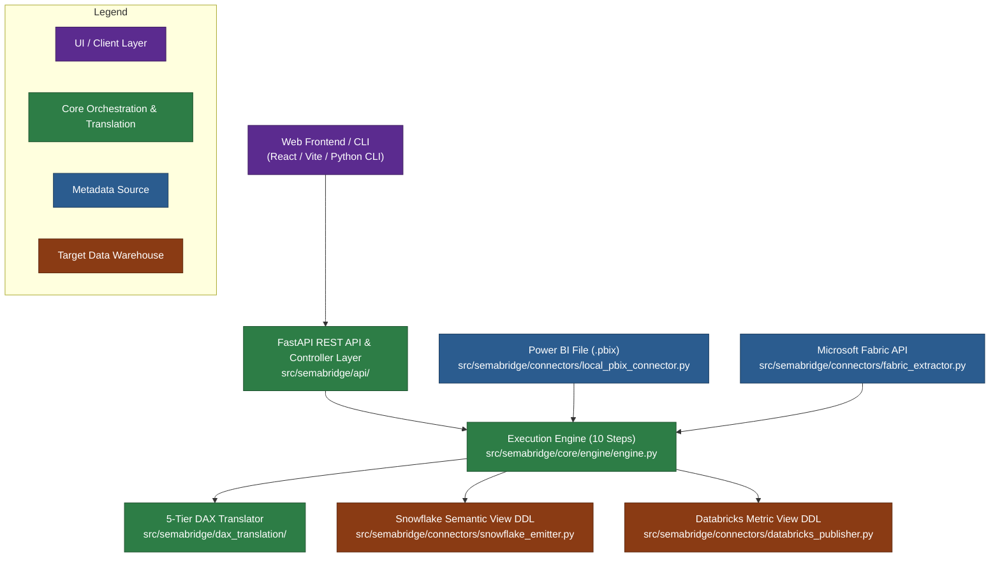

### Suggested Reading Paths

| Role | Primary Sections to Read | Key Takeaway |
| :--- | :--- | :--- |
| **Manager / Sponsor** | Section 0, Section 1, Section 10, Section 14 | High-level capabilities, trust signals (DropLedger), risk classification, and platform boundaries. |
| **New Developer** | Section 0, Section 3, Section 4, Section 5, Section 8, Section 16 | Layered architecture, codebase directory map, step-by-step sync execution flow, data model transformations, and extension how-tos. |
| **QA Engineer** | Section 1, Section 5, Section 6, Section 10, Section 13 | Dry-run vs live sync behaviors, risk classification labels, troubleshooting signatures, and running test suites. |
| **Operator / Client Tech Lead** | Section 2, Section 9, Section 12, Section 13 | Infrastructure context, database schema, authentication options (OAuth/Key-Pair), environment settings, and operations. |

---

## 1. What SemaBridge Is

### Plain Language Overview
Business intelligence (BI) teams frequently build rich semantic models inside Microsoft Power BI, defining measures, business metrics, dimensions, hierarchies, and table relationships. However, modern cloud data platforms like Snowflake and Databricks now offer native semantic layers (such as Snowflake Semantic Views for Cortex Analyst) that require Data Definition Language (DDL) written in SQL and YAML format.

Manually translating hundreds of Power BI measures (written in DAX) into Snowflake SQL metrics and dimensions is slow and error-prone. **SemaBridge automates this migration**. It extracts the data model directly from `.pbix` files or live Microsoft Fabric REST APIs, converts table schemas, relationships, and DAX calculations into standard intermediate representations, and generates ready-to-deploy DDL for Snowflake (and Databricks tech-preview).

### Core Supported Workflows

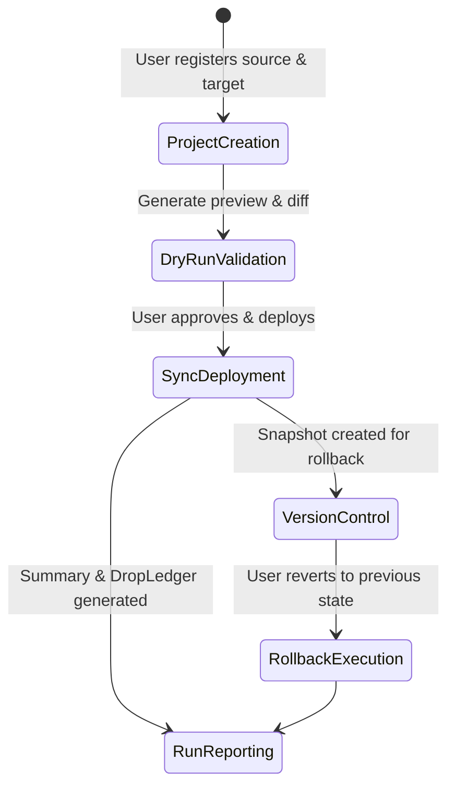

1. **Project Creation**: Users register a source (PBIX file path or Fabric Workspace/Dataset ID) and a target (Snowflake database/schema or Databricks catalog/schema) via [src/semabridge/api/controllers/projects_controller.py](file:///src/semabridge/api/controllers/projects_controller.py).
2. **Dry-Run Validation**: Execution runs with `dry_run=True` to parse formulas, build relationships, and predict flag columns without modifying warehouse objects ([src/semabridge/api/services/dry_run_job_service.py](file:///src/semabridge/api/services/dry_run_job_service.py)).
3. **Sync / Deploy**: The execution engine executes the full pipeline (`deploy=True`), generating base enriched SQL views (`*_ENRICHED`) and executing target DDL statements ([src/semabridge/core/engine/engine.py](file:///src/semabridge/core/engine/engine.py)).
4. **Version History & Rollback**: Every deployment captures an SML model snapshot. Users can audit past versions or restore a previous snapshot using [src/semabridge/repository/semantic_version_manager.py](file:///src/semabridge/repository/semantic_version_manager.py) and [src/semabridge/repository/rollback_orchestrator.py](file:///src/semabridge/repository/rollback_orchestrator.py).
5. **Run Reports & Audit**: Every execution generates a structured JSON/Markdown run report containing step timings, errors, and an explicit DropLedger of dropped measures ([src/semabridge/core/run_summary.py](file:///src/semabridge/core/run_summary.py)).

### Mandatory Glossary

* **PBIX**: Power BI Desktop file format containing data model schema, metadata, binary layout, and compressed tables.
* **TMSL**: Tabular Model Scripting Language, JSON-based schema representation used by Analysis Services and Microsoft Fabric.
* **TOM**: Tabular Object Model, Microsoft's object-oriented hierarchy representing databases, tables, columns, relationships, and measures.
* **DAX**: Data Analysis Expressions, the formula language used in Power BI measures and calculated columns.
* **OSI**: Open Semantic Interface ([src/semabridge/intermediate/models.py](file:///src/semabridge/intermediate/models.py)), canonical vendor-agnostic intermediate format representing raw extracted schemas and expressions.
* **SML**: Semantic Modeling Language ([src/semabridge/sml/models.py](file:///src/semabridge/sml/models.py) & [src/semabridge/formats/sml/models.py](file:///src/semabridge/formats/sml/models.py)), enriched semantic abstraction layer formatted for target DDL emission.
* **Semantic View**: Native Snowflake database object (`CREATE OR REPLACE SEMANTIC VIEW ...`) that presents tables, relationships, dimensions, metrics, and synonyms to Snowflake Cortex Analyst.
* **Enriched View**: Base SQL view (`<TABLE>_ENRICHED`) generated by SemaBridge to project pre-calculated time-intelligence boolean flag columns over physical warehouse tables.
* **Flag Columns**: Precomputed boolean columns (such as `IS_YTD`, `IS_MTD`, `IS_QTD`, `IS_SPLY_YEAR`, `IS_SPLY_MONTH`, `IS_SPLY_QUARTER`, `IS_YTD_SPLY_YEAR`) projected onto enriched views ([src/semabridge/converter/time_intelligence_shapes.py](file:///src/semabridge/converter/time_intelligence_shapes.py)).
* **MAX_DATE Anchoring**: Strategy where time-intelligence date boundaries are computed relative to the dataset's internal maximum fact date (`MAX(fact_date)`) rather than `CURRENT_DATE()`.
* **Tier 1 to 4**: Deterministic DAX translation passes (Tier 1: Direct Aggregations, Tier 2: Strict CALCULATE / Measure Math / Branching, Tier 3: Time Intelligence AST, Tier 4: General AST Parser) implemented in [src/semabridge/dax_translation/tiers_1_4.py](file:///src/semabridge/dax_translation/tiers_1_4.py).
* **Tier 5**: Large Language Model (LLM) fallback translation pass ([src/semabridge/dax_translation/tier5/service.py](file:///src/semabridge/dax_translation/tier5/service.py)) invoked when deterministic tiers decline a DAX expression.
* **DropLedger**: Subsystem ([src/semabridge/core/drop_ledger.py](file:///src/semabridge/core/drop_ledger.py)) that tracks every dropped measure/column, recording the drop stage, reason, and suggested remediation.
* **Dry-Run**: Non-mutating mode (`dry_run=True`) that compiles and validates artifacts without issuing DDL commands to target data stores.
* **Copy Mode**: Sync mode (`sync_mode="copy"`) that creates clean, full replacements of target semantic views ([src/semabridge/core/sync_modes.py](file:///src/semabridge/core/sync_modes.py)).
* **Upsert Mode**: Sync mode (`sync_mode="upsert"`) that inspects existing target views, preserves pre-existing user metrics, and merges new source metrics.
* **Compat Store**: JSON file fallback metadata storage ([src/semabridge/repository/schema_compat.py](file:///src/semabridge/repository/schema_compat.py)) used when SQLAlchemy database sessions are uninitialized.

---

## 2. System Context Diagram

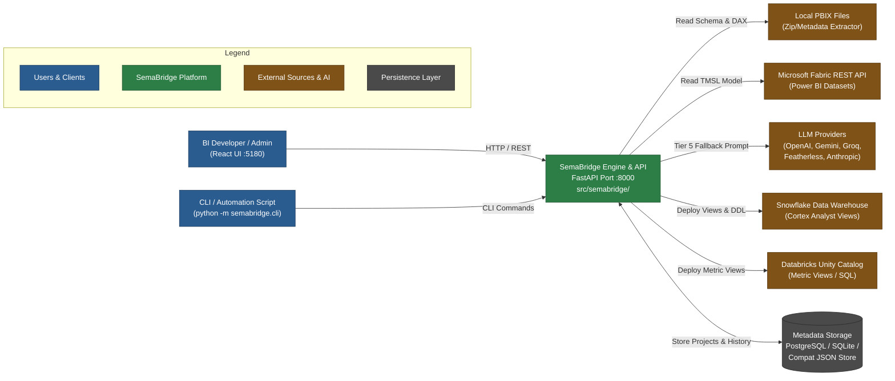

---

## 3. Layered Architecture Diagram and Explanation

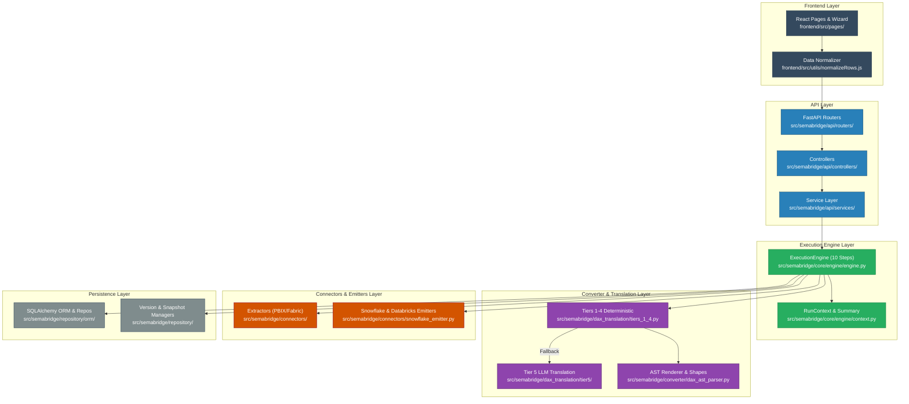

### Layer Responsibilities and Constraints

| Layer | Primary Responsibilities | Strict Non-Responsibilities (What it MUST NOT do) | Key File References |
| :--- | :--- | :--- | :--- |
| **1. Frontend** | Renders React components, wizard steps, diff viewers, mapping tables, and project controls. Normalizes raw API objects via `normalizeRows.js`. | Must **never** compute DAX translation SQL or bypass `normalizeRows.js` when processing `/dry-run` or dry-run-job API output. | [frontend/src/App.jsx](file:///frontend/src/App.jsx)<br/>[frontend/src/utils/normalizeRows.js](file:///frontend/src/utils/normalizeRows.js) |
| **2. API** | Handles HTTP requests, authentication middleware, request validation, controller routing, and service layer orchestration. | Must **never** place inline DDL generation or heavy DAX parsing directly inside route handlers. | [src/semabridge/api/main.py](file:///src/semabridge/api/main.py)<br/>[src/semabridge/api/services/sync_execution_service.py](file:///src/semabridge/api/services/sync_execution_service.py) |
| **3. Execution Engine** | Enforces the strict 10-step execution workflow, manages `RunContext`, coordinates extractors, converters, emitters, and records final `RunSummary`. | Must **never** embed target-specific SQL string formatting inside core orchestration code. | [src/semabridge/core/engine/engine.py](file:///src/semabridge/core/engine/engine.py)<br/>[src/semabridge/core/engine/context.py](file:///src/semabridge/core/engine/context.py) |
| **4. Converters & Translators** | Parses DAX ASTs, runs Tiers 1–4 deterministic translation, manages Tier 5 LLM calls, predicts time-intelligence flag columns, and validates type safety. | Must **never** issue live network calls to data warehouses or mutate global process environment variables. | [src/semabridge/dax_translation/tiers_1_4.py](file:///src/semabridge/dax_translation/tiers_1_4.py)<br/>[src/semabridge/dax_translation/tier5/service.py](file:///src/semabridge/dax_translation/tier5/service.py) |
| **5. Connectors & Emitters** | Extracts source metadata from PBIX/Fabric, constructs target DDL statements (`TABLES`, `RELATIONSHIPS`, `DIMENSIONS`, `METRICS`), and executes Snowflake/Databricks deployments. | Must **never** alter semantic model definitions without recording drops in the `DropLedger`. | [src/semabridge/connectors/snowflake_emitter.py](file:///src/semabridge/connectors/snowflake_emitter.py)<br/>[src/semabridge/connectors/fabric_extractor.py](file:///src/semabridge/connectors/fabric_extractor.py) |
| **6. Persistence** | Manages database sessions, SQLAlchemy ORM models, semantic snapshots, model fingerprints, version control, and fallback JSON compat stores. | Must **never** expose unencrypted API keys or passwords in raw database rows or logs. | [src/semabridge/repository/orm/models.py](file:///src/semabridge/repository/orm/models.py)<br/>[src/semabridge/repository/semantic_version_manager.py](file:///src/semabridge/repository/semantic_version_manager.py) |

---

## 4. Repository and Folder Guide

### Annotated Repository Folder Tree

```text
semabridge_fix/
├── .agents/                    # Agent skills, rules, and workflow extensions
├── Config/                     # Global project & environment YAML configuration files
├── Docs/                       # Architecture, feature specs, usage guides, and ADRs
├── Examples/                   # Sample PBIX models, BIM definitions, and test assets
├── Scratch/                    # Persisted scratch scripts, test dumps, and debugging tools
├── Scripts/                    # Operational automation, maintenance, and setup scripts
├── Tests/                      # Comprehensive pytest suite (Unit, Integration, E2E)
├── frontend/                   # React 18 / Vite single-page web application
│   ├── public/                 # Static assets and favicons
│   └── src/                    # Frontend source code
│       ├── components/         # Reusable UI components, modals, and wizard steps
│       ├── context/            # React context providers (Auth, Sync, Workspace, Theme)
│       ├── hooks/              # Custom React hooks (API, Sync, Browser, Drafts)
│       ├── layouts/            # Page layout wrappers (DashboardLayout, AuthLayout)
│       ├── pages/              # Application views (Projects, Create, Settings, etc.)
│       ├── store/              # Zustand state stores (projectWizardStore, uiStore)
│       ├── theme/              # Color palettes and global styling design tokens
│       └── utils/              # Pure utilities, payload builders, and normalizeRows.js
├── output/                     # Generated artifacts (OSI, SML, DDL SQL, Run Summaries)
├── prompts/                    # LLM prompt templates and evaluation benchmarks
├── src/semabridge/             # Primary Python backend package
│   ├── api/                    # FastAPI web application (routers, controllers, services)
│   ├── auth/                   # Authentication, password hashing, JWTs, and credential encryption
│   ├── cli/                    # Click-based CLI entry points and command groups
│   ├── config/                 # Config loader helpers and path resolvers
│   ├── connectors/             # Source extractors and target DDL emitters/clause builders
│   ├── converter/              # DAX AST parser, safety classifier, and legacy translators
│   ├── core/                   # Core execution engine, step modules, DropLedger, and settings
│   ├── dax_translation/        # Consolidated 5-tier DAX translation service & Tier 5 adapters
│   ├── distributed/            # [Dead/Stub] Ray distributed execution placeholders
│   ├── domain/                 # Domain exception hierarchy and enterprise errors
│   ├── formats/                # SML models, JSON schemas, and YAML validators
│   ├── intermediate/           # Open Semantic Interface (OSI) dataclass definitions
│   ├── migrations/             # Alembic database migration scripts and environment
│   ├── orchestration/          # [Dead/Stub] Temporal workflow worker stubs
│   ├── plugins/                # [Dead/Stub] Base plugin registry stubs
│   ├── repository/             # SQLAlchemy ORM models, DB managers, and version history
│   ├── sml/                    # Re-export shim for semantic model definitions
│   ├── storage/                # [Legacy] Old storage ORM definitions
│   ├── sync/                   # Conflict resolution, type compatibility, and schema evolution
│   └── utils/                  # Logging, sanitization, identifier normalization, graphs
├── .dax_translation_cache.jsonl # File-based Tier 5 LLM translation cache
├── .env.example                # Template environment variables
├── dev.ps1                     # PowerShell local development startup script
├── Makefile                    # Target shortcuts for setup, test, lint, and run
├── pyproject.toml              # Build system, dependencies, and pytest configuration
└── pytest.ini                  # Pytest test discovery settings
```

### Module Table: `src/semabridge/` and `frontend/`

| Folder Path | Purpose | Key Files | Primary Callers | Status |
| :--- | :--- | :--- | :--- | :--- |
| `src/semabridge/api/` | REST API routes, controllers, and business services | `main.py`, `app_setup.py`, `services/sync_execution_service.py` | React Frontend, External REST callers | **Live** |
| `src/semabridge/auth/` | JWT auth, password encryption, credential builders | `encryption.py`, `credential_builder.py`, `passwords.py` | `api/auth_router.py`, `core/engine/auth.py` | **Live** |
| `src/semabridge/cli/` | Click CLI entry points for manual execution | `main.py`, `sync_commands.py`, `deploy_commands.py` | Terminal users, CI pipelines | **Live** |
| `src/semabridge/connectors/` | Metadata extraction & Snowflake/Databricks DDL clause building | `snowflake_emitter.py`, `fabric_extractor.py`, `metrics_clause_builder.py` | `core/engine/` extraction & target steps | **Live** |
| `src/semabridge/converter/` | DAX AST parsing, hazard safety classification, time-intelligence shapes | `dax_ast_parser.py`, `tiered_safety.py`, `time_intelligence_shapes.py` | `dax_translation/tiers_1_4.py`, `connectors/snowflake_emitter.py` | **Live** |
| `src/semabridge/core/engine/` | Modular 10-step Execution Engine package | `engine.py`, `config.py`, `auth.py`, `finalize.py` | `api/services/sync_execution_service.py`, `cli/main.py` | **Live** |
| `src/semabridge/core/engine.py` | Legacy monolithic single-file engine | `engine.py` | None (Superseded by `core/engine/`) | **Legacy / Shim** |
| `src/semabridge/core/execution_engine.py` | Backward-compatibility shim | `execution_engine.py` | `api/websocket_alerts.py`, legacy imports | **Legacy / Shim** |
| `src/semabridge/dax_translation/` | Consolidated 5-Tier DAX translation pipeline | `tiers_1_4.py`, `tier5/service.py`, `tier5/config.py` | `connectors/snowflake_emitter.py`, `api/services/` | **Live** |
| `src/semabridge/distributed/` | Ray distributed execution stubs | `ray/actor_diff.py`, `ray/coordinator.py` | None | **Dead** |
| `src/semabridge/domain/` | Central domain exceptions | `exceptions.py` | Entire codebase | **Live** |
| `src/semabridge/formats/` | SML models, composite models, YAML validation | `sml/models.py`, `yaml_validator.py`, `sanitizer.py` | `core/engine/`, `converter/` | **Live** |
| `src/semabridge/intermediate/` | Open Semantic Interface (OSI) data definitions | `models.py` | Extractor & converter pipeline | **Live** |
| `src/semabridge/migrations/` | Alembic DB migrations | `env.py`, `versions/*.py` | Alembic CLI, DB boots | **Live** |
| `src/semabridge/orchestration/` | Temporal workflow worker stubs | `temporal/workflows.py`, `temporal/worker.py` | None | **Dead** |
| `src/semabridge/plugins/` | Plugin architecture stubs | `base.py`, `registry.py` | None | **Dead** |
| `src/semabridge/repository/` | SQLAlchemy ORM, version history, snapshot management | `orm/models.py`, `semantic_version_manager.py`, `semantic_snapshot_manager.py` | API services, engine finalize step | **Live** |
| `src/semabridge/storage/` | Old ORM storage definitions | `orm.py` | None (Superseded by `repository/orm/`) | **Dead** |
| `src/semabridge/sync/` | Conflict resolution & schema evolution | `conflict_resolver.py`, `schema_evolution.py` | `connectors/snowflake_emitter.py` | **Live** |
| `src/semabridge/utils/` | Identifiers, graph utilities, logging, sanitization | `identifier_normalizer.py`, `null_sentinel.py`, `logger.py` | Entire codebase | **Live** |
| `frontend/src/components/` | Reusable React UI widgets and wizard steps | `DryRunMappingTable.jsx`, `CreateProjectWizard/*` | `frontend/src/pages/` | **Live** |
| `frontend/src/pages/` | Top-level application pages | `ProjectsPage.jsx`, `CreateProjectPage.jsx`, `ProjectDetailPage.jsx` | React Router in `App.jsx` | **Live** |
| `frontend/src/utils/` | Data transformations & row normalization | `normalizeRows.js`, `dryRunPayload.js`, `riskLabels.js` | UI components & pages | **Live** |

### "Where Do I Look When..." Developer Directory

| Problem / Task | Where to Look (Relative File Path) |
| :--- | :--- |
| **A metric was dropped during sync** | [src/semabridge/core/drop_ledger.py](file:///src/semabridge/core/drop_ledger.py) & [src/semabridge/connectors/metrics_clause_builder.py](file:///src/semabridge/connectors/metrics_clause_builder.py) |
| **Generated Snowflake DDL has a syntax error** | [src/semabridge/connectors/snowflake_emitter.py](file:///src/semabridge/connectors/snowflake_emitter.py) & [src/semabridge/connectors/semantic_ddl_sanitizer.py](file:///src/semabridge/connectors/semantic_ddl_sanitizer.py) |
| **The Dry-Run UI page displays the wrong mapping status** | [frontend/src/utils/normalizeRows.js](file:///frontend/src/utils/normalizeRows.js) & [frontend/src/components/DryRunMappingTable.jsx](file:///frontend/src/components/DryRunMappingTable.jsx) |
| **Snowflake Cortex Analyst returns incorrect answers** | [src/semabridge/converter/time_intelligence_shapes.py](file:///src/semabridge/converter/time_intelligence_shapes.py) & [src/semabridge/connectors/synonym_clause.py](file:///src/semabridge/connectors/synonym_clause.py) |
| **Tier 5 LLM translation fails or times out** | [src/semabridge/dax_translation/tier5/service.py](file:///src/semabridge/dax_translation/tier5/service.py) & [src/semabridge/dax_translation/tier5/config.py](file:///src/semabridge/dax_translation/tier5/config.py) |
| **Multi-file PBIX dry-run job gets stuck or fails partially** | [src/semabridge/api/services/dry_run_job_service.py](file:///src/semabridge/api/services/dry_run_job_service.py) & [frontend/src/components/CreateProjectWizard/MultiFileDryRunStatus.jsx](file:///frontend/src/components/CreateProjectWizard/MultiFileDryRunStatus.jsx) |

---

## 5. The Sync Flow, End-to-End

### End-to-End Execution Sequence

```mermaid
sequenceDiagram
    autonumber
    actor User as BI Developer / UI
    participant API as FastAPI Router<br/>(project_router.py)
    participant SVC as Sync Service<br/>(sync_execution_service.py)
    participant ENG as Execution Engine<br/>(engine.py)
    participant DAX as DAX Translator<br/>(tiers_1_4.py / tier5)
    participant EMIT as Snowflake Emitter<br/>(snowflake_emitter.py)
    database SF as Snowflake Warehouse
    database DB as Metadata DB / Snapshot Manager

    User->>API: POST /api/v1/projects/{id}/run (deploy=True, sync_mode="copy")
    API->>SVC: trigger_project_sync(project_id, deploy=True)
    SVC->>ENG: execute(source="pbix", target="snowflake", deploy=True)
    
    ENG->>ENG: Step 1: _step1_load_config()
    ENG->>ENG: Step 2: _step2_init_identifiers()
    ENG->>ENG: Step 3: _step3_resolve_auth()
    ENG->>ENG: Step 4: _step4_extract() [PBIX / Fabric]
    ENG->>ENG: Step 5: _step5_validate_source()
    alt sync_mode == "upsert"
        ENG->>ENG: Step 6a: _step6a_extract_target_for_upsert()
    end
    ENG->>DAX: Step 6: _step6_convert_to_sml() [Translate DAX]
    DAX-->>ENG: SML Model (Tables, Dimensions, Metrics)
    ENG->>ENG: Step 6b: _step6b_predict_anchor_flag_columns()
    ENG->>DB: Step 7: _step7_persist_artifacts() [Save SML Snapshot]
    ENG->>EMIT: Step 8: _step8_convert_to_target() [Build DDL & Enriched Views]
    EMIT->>SF: Step 9: _step9_deploy() [CREATE VIEW & SEMANTIC VIEW]
    SF-->>EMIT: DDL Success Response
    ENG->>DB: Step 10: _step10_finalize() [Record RunSummary & DropLedger]
    ENG-->>SVC: RunSummary Object
    SVC-->>API: JSON Response (Run ID, Status, Artifacts)
    API-->>User: 200 OK + Execution Summary
```

### The Mandatory 10 Engine Steps

The engine implementation in [src/semabridge/core/engine/engine.py](file:///src/semabridge/core/engine/engine.py) executes exactly 10 numbered steps defined in `STEP_NAMES` ([src/semabridge/core/run_summary.py](file:///src/semabridge/core/run_summary.py)):

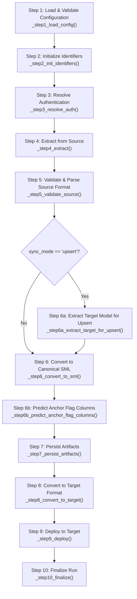

#### Detailed Engine Step Definitions

1. **Step 1: Load & Validate Configuration** ([src/semabridge/core/engine/config.py](file:///src/semabridge/core/engine/config.py)): Resolves environment variables, merges project YAML overrides, and constructs a validated `Settings` object. Failure raises `ConfigValidationError`.
2. **Step 2: Initialize Identifiers** ([src/semabridge/core/engine/config.py](file:///src/semabridge/core/engine/config.py)): Generates a unique execution `run_id` (UUIDv4), normalizes the `project_id`, initializes path output directories, and sets up the `RunContext`.
3. **Step 3: Resolve Authentication** ([src/semabridge/core/engine/auth.py](file:///src/semabridge/core/engine/auth.py)): Validates source and target credentials. For Snowflake, validates Key-Pair or password auth; for Fabric, acquires Entra ID tokens via `credential_builder.py`. Failure raises `AuthenticationError`.
4. **Step 4: Extract from Source** ([src/semabridge/core/engine/extraction/base.py](file:///src/semabridge/core/engine/extraction/base.py)): Reads raw metadata from `.pbix` zip archives, Fabric REST APIs, or Snowflake schemas, outputting a `SourceFormat` object. Failure raises `ExtractionError`.
5. **Step 5: Validate & Parse Source Format** ([src/semabridge/core/engine/conversion/base.py](file:///src/semabridge/core/engine/conversion/base.py)): Converts raw `SourceFormat` into an Open Semantic Interface (OSI) `OSIModel` instance, verifying table definitions and primitive column types. Failure raises `SourceFormatError`.
6. **Step 6a: Extract Target Model for Upsert** (Sub-step in [src/semabridge/core/engine/extraction/base.py](file:///src/semabridge/core/engine/extraction/base.py)): When `sync_mode="upsert"`, extracts the existing Snowflake semantic view definition to build a baseline model before conversion.
7. **Step 6: Convert to Canonical SML** ([src/semabridge/core/engine/conversion/base.py](file:///src/semabridge/core/engine/conversion/base.py)): Converts `OSIModel` to `SMLModel`. Translates DAX formulas into target SQL expressions using the 5-tiered DAX pipeline, validates table relationships, and resolves column mapping overrides. Failure raises `ConversionError`.
8. **Step 6b: Predict Anchor Flag Columns** ([src/semabridge/core/engine/targets/snowflake.py](file:///src/semabridge/core/engine/targets/snowflake.py)): Analyzes SML metrics to predict which time-intelligence flag columns (e.g., `IS_YTD`, `IS_SPLY_YEAR`) will be generated. Re-renders anchor-dependent metrics to reference these flag columns prior to snapshot persistence.
9. **Step 7: Persist Artifacts** ([src/semabridge/core/engine/finalize.py](file:///src/semabridge/core/engine/finalize.py)): Writes SML models, OSI JSON files, and mapping metadata to `output/<project_id>/` and commits a semantic snapshot to the database via `semantic_snapshot_manager.py`. Failure raises `PersistenceError`.
10. **Step 8: Convert to Target Format** ([src/semabridge/core/engine/targets/base.py](file:///src/semabridge/core/engine/targets/base.py)): Generates full DDL syntax (Snowflake `CREATE SEMANTIC VIEW` and enriched base SQL views). Skipped during dry runs (`dry_run=True`).
11. **Step 9: Deploy to Target** ([src/semabridge/core/engine/deployment/base.py](file:///src/semabridge/core/engine/deployment/base.py)): Connects to Snowflake/Databricks, executes base view creation SQL and semantic view DDL, and validates live deployment. Failure raises `DeploymentError`.
12. **Step 10: Finalize Run** ([src/semabridge/core/engine/finalize.py](file:///src/semabridge/core/engine/finalize.py)): Compiles step timings, extracts `DropLedger` records, checks deployment reconciliation, updates project status, and returns the final structured `RunSummary`.

### Dry-Run Execution Flow vs. Live Deploy

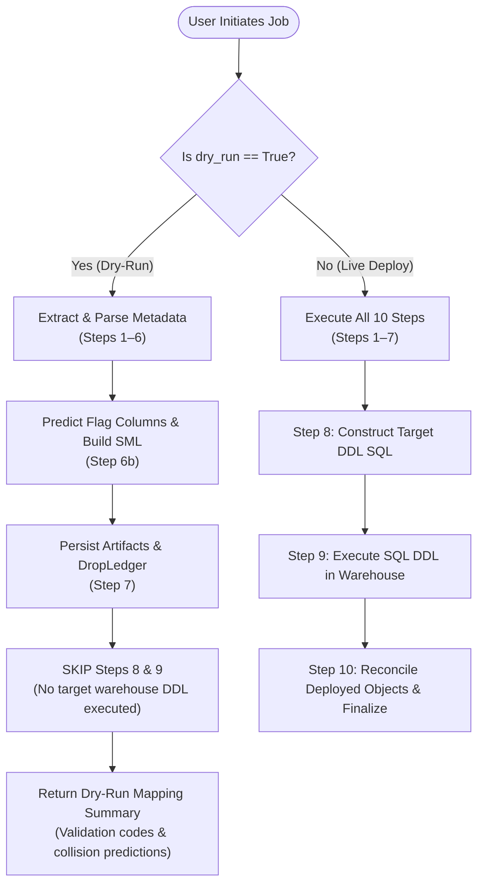

#### What Dry-Run Cannot Know Without a Live Connection
* **Target Schema Drifts**: Dry-run uses offline column name resolution and cannot detect uncommitted target warehouse DDL changes made outside SemaBridge.
* **Warehouse Authority Restrictions**: Dry-run cannot verify whether the active Snowflake role possesses sufficient `CREATE VIEW` or `CREATE SEMANTIC VIEW` privileges on the target schema.
* **Target Data Values**: Max-date anchor calculation falls back to `CURRENT_DATE()` during offline dry runs when a live connection is omitted.

### Multi-PBIX Fan-Out Flow

When users upload multiple PBIX files simultaneously (e.g., in the project creation wizard), SemaBridge delegates orchestration to [src/semabridge/api/services/dry_run_job_service.py](file:///src/semabridge/api/services/dry_run_job_service.py).

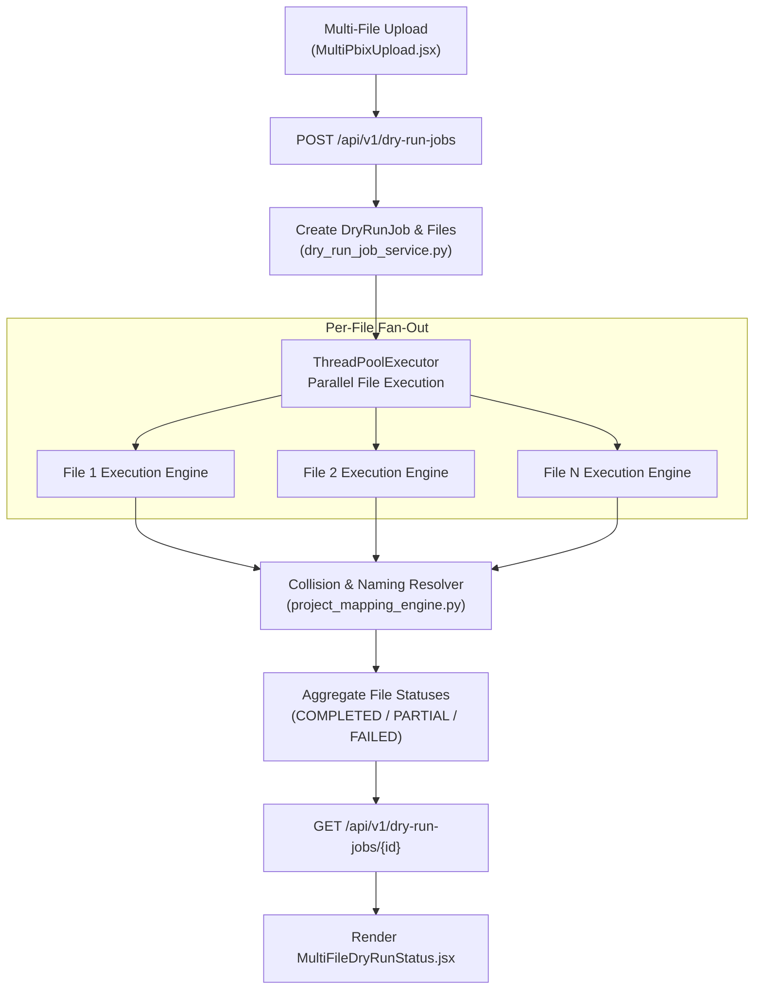

### Failure and Remediation Loop

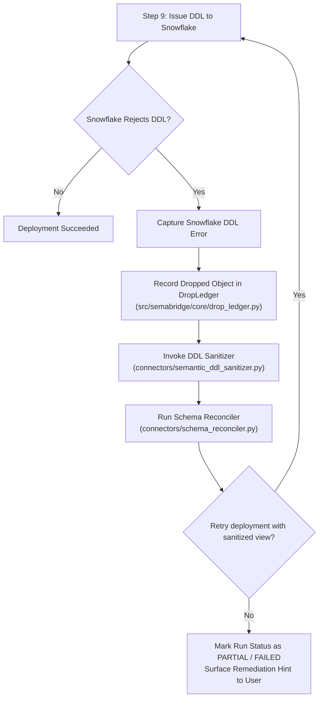

### Sync Modes: Copy vs. Upsert

| Feature / Behavior | Copy Mode (`sync_mode="copy"`) | Upsert Mode (`sync_mode="upsert"`) |
| :--- | :--- | :--- |
| **Target View Handling** | Replaces target semantic view completely (`CREATE OR REPLACE SEMANTIC VIEW ...`). | Reads existing target view DDL first ([src/semabridge/connectors/snowflake_extractor.py](file:///src/semabridge/connectors/snowflake_extractor.py)). |
| **Existing Metrics** | Erases any target metrics not present in the incoming source model. | Preserves pre-existing target metrics, merging new incoming source metrics. |
| **Relationship Management** | Rebuilds relationship join paths entirely from source SML. | Merges source relationships with existing target relationships. |
| **Engine Execution Layer** | Bypasses Step 6a. | Triggers **Step 6a** (`_step6a_extract_target_for_upsert`) prior to SML conversion. |

---

## 6. The DAX Translation Pipeline

### Tiered DAX Expression Flow

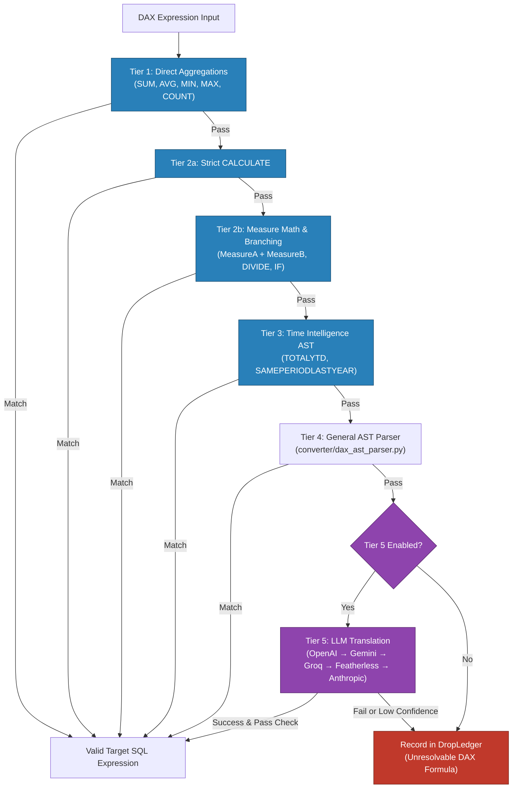

### Deterministic Translation (Tiers 1–4)

Deterministic translation is managed by `translate_tiers_1_4()` in [src/semabridge/dax_translation/tiers_1_4.py](file:///src/semabridge/dax_translation/tiers_1_4.py):

* **Tier 1 (Direct Aggregations)**: Matches pattern `SUM(Table[Column])` and renders `SUM("TABLE"."COLUMN")`.
* **Tier 2a (Strict Single-Predicate CALCULATE)**: Handles simple filtered measure expressions like `CALCULATE(SUM(Sales[Amount]), Sales[Region] = "North")` into `SUM(CASE WHEN Sales.Region = 'North' THEN Sales.Amount END)`.
* **Tier 2b (Measure Math & Branching)**: Resolves measure references and translates binary arithmetic (`[Sales] - [Cost]`) and logical branching (`IF([Sales] > 100, 1, 0)` or `DIVIDE(num, den)`).
* **Tier 3 (Time Intelligence AST)**: Translates `TOTALYTD`, `TOTALMTD`, `TOTALQTD`, and `SAMEPERIODLASTYEAR` using AST node transformations into date-bounded `CASE WHEN` blocks over flag columns.
* **Tier 4 (General AST Parser)**: Employs `try_ast_translate()` ([src/semabridge/converter/dax_ast_parser.py](file:///src/semabridge/converter/dax_ast_parser.py)) for general expressions, function registry mapping, and scalar functions.

### Safety Pipeline & Expression Validators

Before issuing SQL, expressions pass through validators in [src/semabridge/converter/tiered_safety.py](file:///src/semabridge/converter/tiered_safety.py) and [src/semabridge/connectors/type_safety_validator.py](file:///src/semabridge/connectors/type_safety_validator.py):
1. **Schema References Validator**: Verifies that every referenced table and column exists in the extracted dataset.
2. **Type Safety Validator**: Confirms arithmetic operations are performed exclusively on numeric columns.
3. **Nested Aggregates Inspector**: Detects invalid SQL constructs such as `SUM(AVG(x))` or window functions (`OVER (...)`) placed inside Snowflake metric definitions.
4. **Unreachable Dimensions Filter**: Rejects measures that cross table boundaries lacking valid relationship paths.
5. **Null Sentinel Validator**: Injects `COALESCE` handling for missing or nullable dimension joins ([src/semabridge/utils/null_sentinel.py](file:///src/semabridge/utils/null_sentinel.py)).

### Tier 5 LLM Translation Framework

When deterministic tiers decline a DAX formula, execution falls through to `Tier5Service` ([src/semabridge/dax_translation/tier5/service.py](file:///src/semabridge/dax_translation/tier5/service.py)):

* **Provider Chain Priority**:
  `Tier5Config.resolve()` ([src/semabridge/dax_translation/tier5/config.py](file:///src/semabridge/dax_translation/tier5/config.py)) evaluates providers in the following default order:
  1. `openai` (`gpt-4o-mini`)
  2. `gemini` (`gemini-1.5-flash`)
  3. `groq` (`llama-3.3-70b-versatile`)
  4. `featherless` (Multi-model failover: DeepSeek, Qwen, Mistral, Llama)
  5. `anthropic` (Claude API)

  *Priority Rule*: Providers configured via the Settings UI (stored encrypted in the database) are automatically tried **before** `.env`-only providers.

* **Batching & Performance**: Batches up to 20 DAX expressions per LLM prompt invocation to reduce API overhead.
* **Translation Cache**: Stores verified LLM translations in `.dax_translation_cache.jsonl` to avoid duplicate API calls.
* **Confidence Threshold**: Default minimum acceptable self-reported confidence is `0.55`.

> [!IMPORTANT]
> **Risk Label Independence Rule**: The 4-level risk label (`CLEAN`, `MEDIUM`, `HIGH`, `BLOCKED`) assigned to a measure is derived **strictly by the hazard complexity classifier** ([src/semabridge/converter/tiered_safety.py](file:///src/semabridge/converter/tiered_safety.py)). The LLM's self-reported confidence score is displayed as informational metadata only and **never** lowers a measure's risk classification.

---

## 7. DDL Generation

### Snowflake DDL Architecture

Snowflake DDL generation is driven by [src/semabridge/connectors/snowflake_emitter.py](file:///src/semabridge/connectors/snowflake_emitter.py) using modular clause builders:

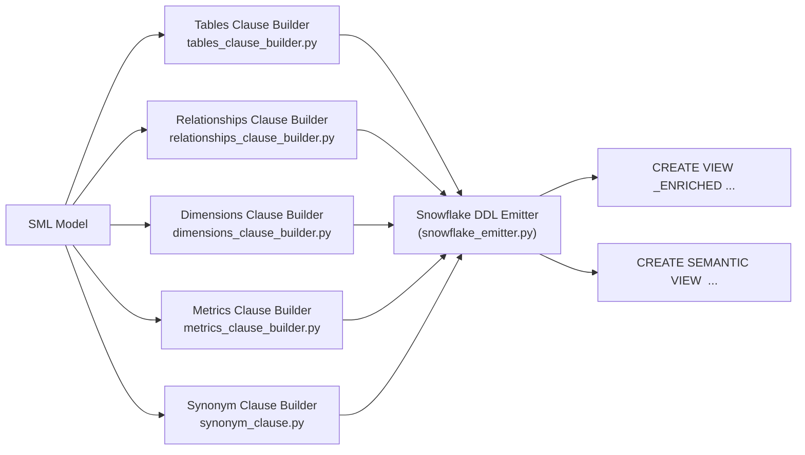

* **Tables Clause Builder** ([src/semabridge/connectors/tables_clause_builder.py](file:///src/semabridge/connectors/tables_clause_builder.py)): Maps physical database tables, pointing fact tables to their corresponding `*_ENRICHED` views when flag columns exist.
* **Relationships Clause Builder** ([src/semabridge/connectors/relationships_clause_builder.py](file:///src/semabridge/connectors/relationships_clause_builder.py)): Converts Power BI relationships into Snowflake semantic join definitions (`JOIN <T1> AND <T2> ON ...`).
* **Dimensions Clause Builder** ([src/semabridge/connectors/dimensions_clause_builder.py](file:///src/semabridge/connectors/dimensions_clause_builder.py)): Emits physical columns and attributes as dimensions, assigning logical data types.
* **Metrics Clause Builder** ([src/semabridge/connectors/metrics_clause_builder.py](file:///src/semabridge/connectors/metrics_clause_builder.py)): Constructs aggregate metric expressions (`SUM`, `COUNT`, `AVERAGE`), replacing DAX functions with valid Snowflake SQL.
* **Synonym Clause Builder** ([src/semabridge/connectors/synonym_clause.py](file:///src/semabridge/connectors/synonym_clause.py)): Injects natural-language synonyms for Cortex Analyst.

### Enriched Views and Flag Columns

To support DAX time-intelligence formulas (such as `TOTALYTD`) in Snowflake without complex subqueries inside metric definitions, SemaBridge generates an enriched base SQL view (`<TABLE>_ENRICHED`) for each fact table:

1. **Offline Prediction (Step 6b)**: `predict_anchor_flag_map()` in [src/semabridge/converter/time_intelligence_shapes.py](file:///src/semabridge/converter/time_intelligence_shapes.py) scans all metrics to determine required time shapes.
2. **Live Creation**: `_create_enriched_view()` in [src/semabridge/connectors/snowflake_emitter.py](file:///src/semabridge/connectors/snowflake_emitter.py) projects precalculated boolean expressions onto the base table.
3. **Table Routing**: The semantic view `TABLES` clause routes fact table references to `SALESFACT_ENRICHED` instead of `SALESFACT`.

```sql
-- Generated Base Enriched View: SALESFACT_ENRICHED
CREATE OR REPLACE VIEW DEMO_DB.PUBLIC.SALESFACT_ENRICHED AS
SELECT 
    SALESFACT.*,
    (SALESFACT.ORDER_DATE >= DATE_TRUNC('YEAR', (SELECT MAX(ORDER_DATE) FROM SALESFACT))
     AND SALESFACT.ORDER_DATE <= (SELECT MAX(ORDER_DATE) FROM SALESFACT)) AS "IS_YTD"
FROM DEMO_DB.PUBLIC.SALESFACT;
```

### Synthetic Before-and-After Example

#### Input DAX Measure
```dax
Total Sales YTD = TOTALYTD(SUM(Sales[SalesAmount]), Dates[FullDate])
```

#### Generated Target DDL Snippet
```sql
-- Generated Snowflake Base Enriched View
CREATE OR REPLACE VIEW DEMO_DB.PUBLIC.SALES_ENRICHED AS
SELECT 
    SALES.*,
    (SALES.FULLDATE >= DATE_TRUNC('YEAR', (SELECT MAX(FULLDATE) FROM SALES)) 
     AND SALES.FULLDATE <= (SELECT MAX(FULLDATE) FROM SALES)) AS "IS_YTD"
FROM DEMO_DB.PUBLIC.SALES;

-- Generated Snowflake Semantic View DDL
CREATE OR REPLACE SEMANTIC VIEW DEMO_DB.PUBLIC.SALES_MODEL
    TABLES (
        SALES_ENRICHED AS SALES BASE_TABLE = DEMO_DB.PUBLIC.SALES_ENRICHED
    )
    METRICS (
        SALES.TOTAL_SALES_YTD AS SUM(CASE WHEN SALES."IS_YTD" THEN SALES.SALESAMOUNT ELSE NULL END)
            COMMENT = 'Translated from DAX TOTALYTD'
    );
```

---

## 8. Data Models in the Pipeline

SemaBridge transforms metadata through four formal representations:

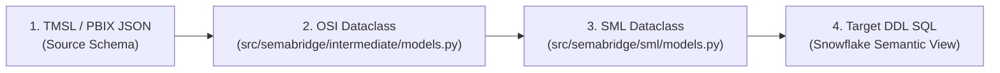

### Model Transformation Stages

```json
// Stage 1: Raw TMSL Measure Snippet
{
  "name": "Total Quantity",
  "expression": "SUM(Sales[Quantity])",
  "dataType": "int64"
}
```

```python
# Stage 2: Open Semantic Interface (OSI) Dataclass
# Defined in: src/semabridge/intermediate/models.py
OSIMeasure(
    name="Total Quantity",
    expression="SUM(Sales[Quantity])",
    dataset="Sales",
    description="Raw extracted measure"
)
```

```python
# Stage 3: Semantic Modeling Language (SML) Dataclass
# Defined in: src/semabridge/sml/models.py & src/semabridge/formats/sml/models.py
SMLMetric(
    name="TOTAL_QUANTITY",
    unique_name="SALES.TOTAL_QUANTITY",
    sql_expression="SUM(SALES.QUANTITY)",
    data_type="INTEGER",
    source_measure="Total Quantity",
    risk_label="CLEAN"
)
```

```sql
-- Stage 4: Final Target Snowflake DDL
-- Generated by: src/semabridge/connectors/snowflake_emitter.py
METRICS (
    SALES.TOTAL_QUANTITY AS SUM(SALES.QUANTITY)
        COMMENT = 'Migrated from Power BI Total Quantity'
)
```

---

## 9. Persistence and Run Tracking

### Persistence Subsystem Architecture

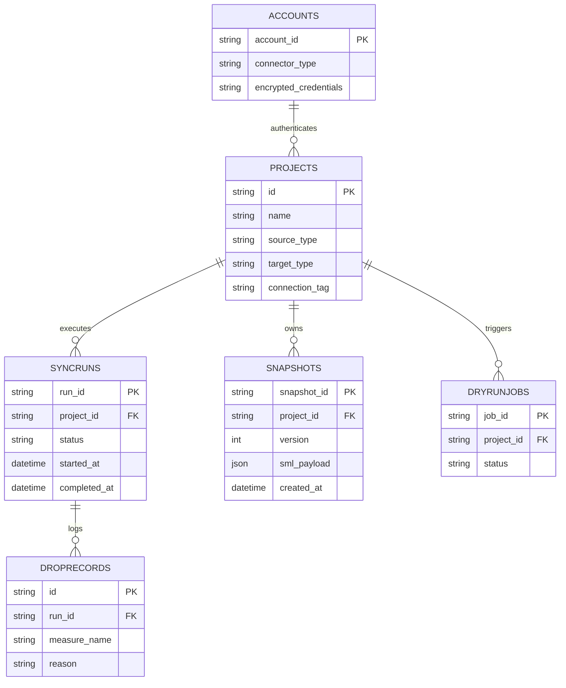

### Persistence Components Inventory

| Storage Mechanism | Physical Location / File Path | Purpose & Contained Data |
| :--- | :--- | :--- |
| **SQLAlchemy ORM Database** | Configured via `DATABASE_URL` (SQLite file `semabridge.db` or PostgreSQL) | Projects, sync runs, semantic snapshots, user accounts, dry-run jobs ([src/semabridge/repository/orm/models.py](file:///src/semabridge/repository/orm/models.py)). |
| **Compat File Store** | `.schema_compat.json` ([src/semabridge/repository/schema_compat.py](file:///src/semabridge/repository/schema_compat.py)) | Fallback project and snapshot metadata storage when DB sessions are uninitialized. |
| **Encrypted Credential Store** | `accounts` table ([src/semabridge/auth/encryption.py](file:///src/semabridge/auth/encryption.py)) | Stores Fernet-encrypted passwords, tokens, and OAuth keys. |
| **LLM Translation Cache** | `.dax_translation_cache.jsonl` | File-based cache storing prompt hashes and verified Tier 5 DAX-to-SQL translations. |
| **Output Directory** | `output/<project_id>/` | Serialized OSI models, SML YAML snapshots, generated SQL files, and run reports. |

#### Storage Overlap and Architectural Note
> [!NOTE]
> **Compat Store vs. ORM Tables**: The codebase contains both a relational SQLAlchemy ORM layer ([src/semabridge/repository/orm/](file:///src/semabridge/repository/orm/)) and a legacy JSON file store (`schema_compat.py`). The ORM is the primary persistence engine for all web API operations. `schema_compat.py` serves as a fallback for standalone CLI executions operating without a configured database.

---

## 10. Reporting and Trust Signals

### DropLedger Subsystem

The `DropLedger` ([src/semabridge/core/drop_ledger.py](file:///src/semabridge/core/drop_ledger.py)) records every measure or column dropped during extraction, translation, or DDL emission. Each entry includes:
* **Drop Stage**: Extraction, Parsing, Translation, Type Safety, or DDL Emission.
* **Reason Code**: e.g., `UNSUPPORTED_DAX_FUNCTION`, `MISSING_FACT_COLUMN`, `INVALID_NESTED_AGGREGATE`.
* **Remediation Hint**: Actionable advice for fixing the measure in Power BI before re-syncing.

### 4-Tier Hazard Risk Labels

Every measure processed by SemaBridge receives a deterministic safety classification ([src/semabridge/converter/tiered_safety.py](file:///src/semabridge/converter/tiered_safety.py)):

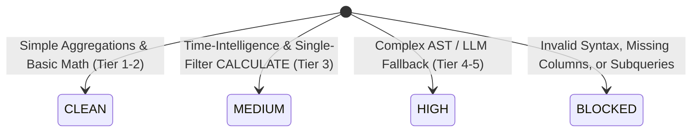

* **`CLEAN`**: Direct column aggregations (`SUM`, `COUNT`, `AVG`) and simple measure math. Zero operational risk.
* **`MEDIUM`**: Standard time-intelligence formulas (`TOTALYTD`, `SAMEPERIODLASTYEAR`) anchored to verified flag columns.
* **`HIGH`**: Measures translated via Tier 4 AST heuristics or Tier 5 LLM fallback. Requires user review.
* **`BLOCKED`**: Measures that violate warehouse rules (e.g., metric referencing another metric directly) or contain unparseable syntax. Dropped from emission.

---

## 11. Frontend Map

### React Single-Page Application Architecture

The frontend is a React 18 application built with Vite ([frontend/src/App.jsx](file:///frontend/src/App.jsx)):

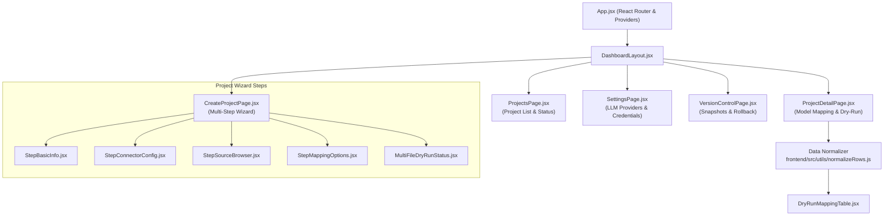

### Mandatory Data Normalization Layer

All dry-run and mapping table responses from the API **must** pass through `normalizeRows()` in [frontend/src/utils/normalizeRows.js](file:///frontend/src/utils/normalizeRows.js).

> [!CAUTION]
> **Component Constraint**: UI components must **never** consume raw `/dry-run` or `/dry-run-jobs` JSON objects directly. `normalizeRows.js` enforces an explicit allowlist and extracts auto-resolved naming collisions, advisory categories, and complexity tiers. Bypassing this layer causes silent display drops and UI state inconsistencies.

---

## 12. Configuration, Authentication, and Secrets

### Configuration Sources and Order of Precedence

1. **Process Environment Variables** (Highest precedence)
2. **Project File Options** (`semabridge.yaml` or `config.yaml`)
3. **Application Default Settings** ([src/semabridge/core/settings.py](file:///src/semabridge/core/settings.py))

### Snowflake Authentication Modes Supported in Code

1. **Password Authentication**: Username and password configured via `SNOWFLAKE_USER` and `SNOWFLAKE_PASSWORD`.
2. **Key-Pair Authentication**: Private key path and passphrase resolved via `SNOWFLAKE_PRIVATE_KEY_PATH` and `SNOWFLAKE_PRIVATE_KEY_PASSPHRASE` in [src/semabridge/connectors/snowflake_connection.py](file:///src/semabridge/connectors/snowflake_connection.py).
3. **OAuth / SSO Authentication**: Identity access tokens injected via `account_id` in [src/semabridge/auth/credential_builder.py](file:///src/semabridge/auth/credential_builder.py).

### Secret Storage & Encryption Engine

All sensitive tokens, private keys, and passwords stored in the database are encrypted at rest using Fernet symmetric encryption ([src/semabridge/auth/encryption.py](file:///src/semabridge/auth/encryption.py)).
* Encryption key resolved from `SEMABRIDGE_ENCRYPTION_KEY`.
* If unset in local development, a key file is auto-generated in `Config/.secret.key`.

---

## 13. Running and Operating It

### Starting Local Development Servers

```powershell
# Option 1: Using the PowerShell automation script
.\dev.ps1

# Option 2: Manual startup
# Terminal 1: Backend API (FastAPI)
.venv\Scripts\python.exe -m uvicorn semabridge.api.main:app --host 127.0.0.1 --port 8000 --reload

# Terminal 2: Frontend Web UI (Vite)
cd frontend
npm run dev
```

* **Backend API URL**: `http://localhost:8000` (Swagger UI at `/docs`)
* **Frontend UI URL**: `http://localhost:5180`

### Executing Test Suites

```powershell
# Run full pytest suite using virtual environment
.venv\Scripts\python.exe -m pytest

# Run fast unit tests (excluding slow integration tests)
.venv\Scripts\python.exe -m pytest -m "not slow" --ignore=Tests/test_dry_run.py
```

#### Pre-existing Test Suite Baseline
As of verification commit `fa1f4fa97b610eaf63578243f176eadd553d6ae8`:
* **Total Tests Collected**: 1,561
* **Passing**: 1,484
* **Skipped**: 4
* **Pre-existing Failures**: 73 (primarily mock expectations and unconfigured external integration environments).

### Common Operational Failure Signatures & Remediation

| Error Signature / Log Line | Meaning / Root Cause | File to Inspect & Repair |
| :--- | :--- | :--- |
| `invalid identifier 'IS_YTD'` | The generated semantic view references a flag column that does not exist on the base enriched view. | [src/semabridge/connectors/anchor_flag_rerender.py](file:///src/semabridge/connectors/anchor_flag_rerender.py) |
| `bare '_' identifier` | Identifier sanitizer stripped invalid characters down to a single underscore. | [src/semabridge/utils/identifier_normalizer.py](file:///src/semabridge/utils/identifier_normalizer.py) |
| `empty clause` | DDL builder generated an empty `METRICS ()` or `DIMENSIONS ()` block. | [src/semabridge/connectors/metrics_clause_builder.py](file:///src/semabridge/connectors/metrics_clause_builder.py) |
| `SALESFACT_ENRICHED does not exist` | Base enriched SQL view deployment failed or was executed out of order before semantic view creation. | [src/semabridge/connectors/snowflake_emitter.py](file:///src/semabridge/connectors/snowflake_emitter.py) |

---

## 14. Design Decisions and Known Limitations

### Snowflake Semantic Layer Rules Shaping Design

1. **No Metric-to-Metric Direct Expressions**: Snowflake metrics cannot reference other metrics directly in an expression (e.g., `MetricA / MetricB` is invalid syntax inside a Snowflake metric block). *Design Decision*: SemaBridge decomposes measure dependencies inline or generates calculated base view columns ([src/semabridge/connectors/metrics_clause_builder.py](file:///src/semabridge/connectors/metrics_clause_builder.py)).
2. **No Subqueries or Window Functions in Metrics**: Snowflake metrics reject `OVER (PARTITION BY ...)` or nested `SELECT` queries. *Design Decision*: Subquery logic is offloaded to pre-calculated boolean flag columns in `*_ENRICHED` base views.
3. **Fact-to-Dimension Scoping**: Metrics must explicitly declare table aliases matching relationship paths.

### Metrics That Cannot Be Expressed

* **Disconnected KPI Selectors**: Power BI patterns using unlinked slicer tables to dynamically pick metrics via `SWITCH(TRUE(), SELECTEDVALUE(...))` cannot be translated into static SQL semantic views.
* **Non-Scalar Rolling Windows**: Complex DAX expressions using `WINDOW()`, `OFFSET()`, or dynamic `EARLIER()` recursion are flagged as `BLOCKED` and logged in the `DropLedger`.

### Rationale for Max-Date Anchoring over `CURRENT_DATE()`

Real-world enterprise BI models often contain static historical datasets (e.g., sales data ending in 2024). Using Snowflake's native `CURRENT_DATE()` for `YTD` calculations in 2026 would result in 0 rows returned. SemaBridge anchors date windows to `MAX(fact_date)` within the dataset, ensuring time-intelligence metrics return accurate data ([src/semabridge/converter/time_intelligence_shapes.py](file:///src/semabridge/converter/time_intelligence_shapes.py)).

---

## 15. Legacy, Dead, and Duplicated Code

The codebase contains legacy shims and unused modules from earlier architectural iterations. The table below documents their status:

| Module / File Path | Current Status | Replaced By / Live Path | Safe to Remove? | Architectural Debt Notes |
| :--- | :--- | :--- | :--- | :--- |
| `src/semabridge/core/engine.py` | **Legacy** | [src/semabridge/core/engine/engine.py](file:///src/semabridge/core/engine/engine.py) | Yes | 1,120-line single-file engine. Kept for historical reference. |
| `src/semabridge/core/execution_engine.py` | **Legacy Shim** | [src/semabridge/core/engine/engine.py](file:///src/semabridge/core/engine/engine.py) | No (Re-exports) | Re-exports classes for legacy imports and dynamic string references. |
| `src/semabridge/core/executor.py` | **Legacy Shim** | `ExecutionEngine` | Yes | Legacy `CLIExecutor` wrapper. |
| `src/semabridge/storage/orm.py` | **Dead** | [src/semabridge/repository/orm/models.py](file:///src/semabridge/repository/orm/models.py) | Yes | Superseded by the `repository/orm/` package. |
| `src/semabridge/sml/assembler.py` | **Dead** | [src/semabridge/formats/sml/assembler.py](file:///src/semabridge/formats/sml/assembler.py) | Yes | Duplicate top-level package superseded by `formats/sml/`. |
| `src/semabridge/distributed/ray/` | **Dead** | None | Yes | Unused Ray actor distributed stubs. |
| `src/semabridge/orchestration/temporal/` | **Dead** | None | Yes | Unused Temporal worker orchestration stubs. |
| `src/semabridge/plugins/` | **Dead** | None | Yes | Unused plugin architecture stubs. |

---

## 16. Extending the System

### Verified Extension How-Tos

#### 1. Adding a New Source Connector
1. Implement metadata extraction in `src/semabridge/connectors/<new_source>_extractor.py`.
2. Add source format parsing to [src/semabridge/core/source_format.py](file:///src/semabridge/core/source_format.py).
3. Bind extraction logic to Step 4 in [src/semabridge/core/engine/extraction/base.py](file:///src/semabridge/core/engine/extraction/base.py).

#### 2. Adding a New Target Connector
1. Create a DDL emitter in `src/semabridge/connectors/<new_target>_emitter.py`.
2. Register target conversion in Step 8 ([src/semabridge/core/engine/targets/base.py](file:///src/semabridge/core/engine/targets/base.py)).
3. Register deployment handler in Step 9 ([src/semabridge/core/engine/deployment/base.py](file:///src/semabridge/core/engine/deployment/base.py)).

#### 3. Adding a Deterministic DAX Translation Rule
1. Add function pattern to `DAXTranslator` in [src/semabridge/converter/dax_translator.py](file:///src/semabridge/converter/dax_translator.py).
2. Register AST node rendering in [src/semabridge/converter/dax_ast_parser.py](file:///src/semabridge/converter/dax_ast_parser.py).
3. Update [src/semabridge/dax_translation/tiers_1_4.py](file:///src/semabridge/dax_translation/tiers_1_4.py).

#### 4. Adding a Tier 5 LLM Provider
1. Implement adapter extending `BaseLLMAdapter` in `src/semabridge/dax_translation/tier5/adapters/<provider>_adapter.py`.
2. Register provider in `Tier5Config` ([src/semabridge/dax_translation/tier5/config.py](file:///src/semabridge/dax_translation/tier5/config.py)).
3. Add API key settings handler to [src/semabridge/repository/llm_provider_credentials.py](file:///src/semabridge/repository/llm_provider_credentials.py).

#### 5. Adding an API Endpoint with a Frontend Page
1. Define FastAPI router in `src/semabridge/api/routers/<feature>_router.py`.
2. Register router in [src/semabridge/api/bootstrap/router_registry.py](file:///src/semabridge/api/bootstrap/router_registry.py).
3. Create React page in `frontend/src/pages/<Feature>Page.jsx`.
4. Register route in [frontend/src/App.jsx](file:///frontend/src/App.jsx) and navigation link in [frontend/src/components/LeftNavigation.jsx](file:///frontend/src/components/LeftNavigation.jsx).

---

## 17. Keeping This Document Current

### Verification Record

* **Verified Against Git Commit**: `fa1f4fa97b610eaf63578243f176eadd553d6ae8`
* **Git Branch**: `sabiha_DAX_feature`
* **Verification Date**: October 6, 2026

### Code Change Update Checklist

When performing code modifications, update this document according to the following checklist:

- [ ] **Engine Step Modifications**: Update Section 5 step numbers if [src/semabridge/core/engine/engine.py](file:///src/semabridge/core/engine/engine.py) or `STEP_NAMES` change.
- [ ] **DAX Tier Changes**: Update Section 6 if new deterministic tiers or LLM providers are added.
- [ ] **ORM / Database Schema Changes**: Update Section 9 ER diagram and Alembic references when modifying [src/semabridge/repository/orm/models.py](file:///src/semabridge/repository/orm/models.py).
- [ ] **Frontend Component Normalization**: Update Section 11 if `normalizeRows.js` or wizard steps are modified.
- [ ] **New / Removed Files**: Re-verify folder tree in Section 4 and legacy table in Section 15.
