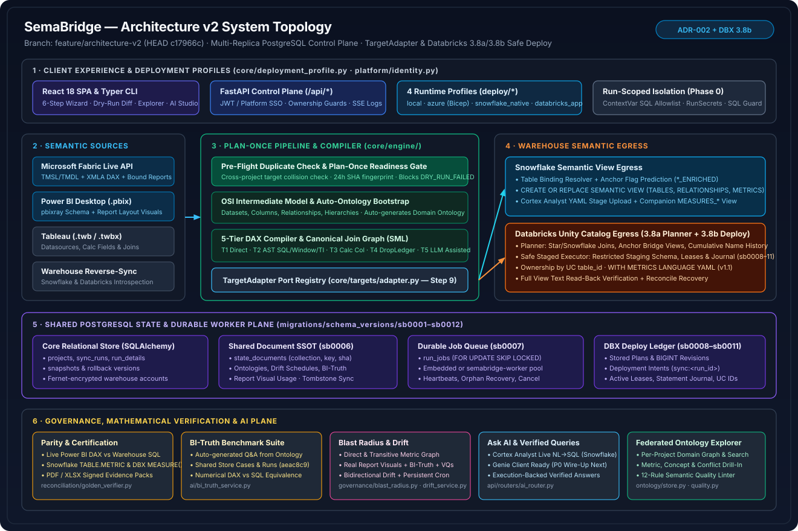
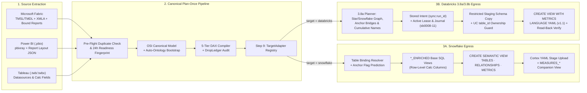
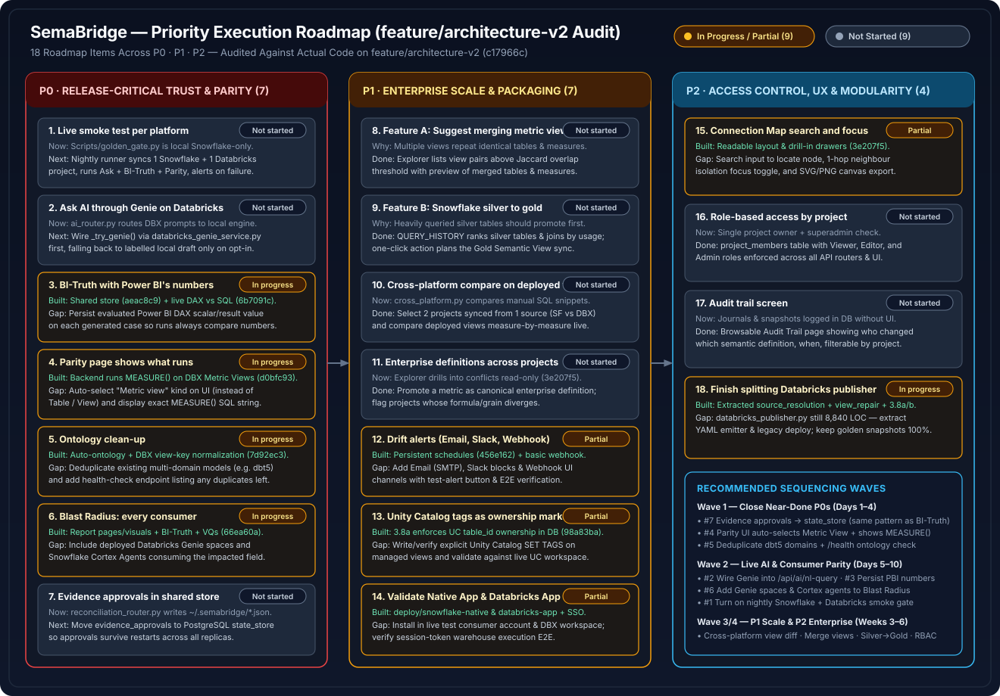
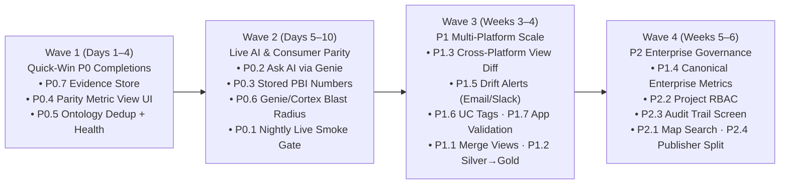

# SemaBridge — Architecture  & Priority Roadmap Specification

- **Document Version**: 2.0.0
- **Verified Branch**: `feature/architecture-v2`
- **Verified Commit**: `c17966c` (`feat(dry-run): Target Field shows the name that deploys on Databricks`)
- **Verification Date**: November 26, 2026
- **Related ADR**: [ADR-002 — Architecture v2](decisions/ADR-002-architecture-v2.md) | [Quality Gates Reference](GATES.md)

---

## Table of Contents

1. [Executive Summary](#1-executive-summary)
2. [System Architecture v2 Overview](#2-system-architecture-v2-overview)
3. [Architecture v2 Pillars (Phases 0–4 + Databricks 3.8a/3.8b)](#3-architecture-v2-pillars-phases-04--databricks-38a38b)
4. [End-to-End Semantic Sync Pipeline (Snowflake vs. Databricks)](#4-end-to-end-semantic-sync-pipeline-snowflake-vs-databricks)
5. [Shared PostgreSQL Persistence & Schema Migrations (`sb0001`–`sb0012`)](#5-shared-postgresql-persistence--schema-migrations-sb0001sb0012)
6. [Governance, Mathematical Verification & AI Plane](#6-governance-mathematical-verification--ai-plane)
7. [Repository Module Map](#7-repository-module-map)
8. [Priority Execution Roadmap (P0 · P1 · P2 — Audited Against `feature/architecture-v2`)](#8-priority-execution-roadmap-p0--p1--p2--audited-against-featurearchitecture-v2)
9. [Recommended Delivery Waves & Quality Gates](#9-recommended-delivery-waves--quality-gates)

---

## 1. Executive Summary

**SemaBridge** is an enterprise semantic layer migration, synchronization, and governance platform. It ingests business models from **Microsoft Fabric** (live TMSL/TMDL + XMLA DAX + bound reports), **Power BI Desktop (`.pbix`)**, **Tableau (`.twb/.twbx`)**, and reverse-synced cloud warehouses, compiles DAX measures and tabular join graphs through a **5-Tier DAX Translation Compiler**, and deploys native warehouse semantic objects to **Snowflake Semantic Views** (for Cortex Analyst) and **Databricks Unity Catalog Metric Views** (for AI/BI Genie).

On **`feature/architecture-v2`**, SemaBridge transitions from a single-process local runtime to a **multi-replica, cloud-native control plane**:
- **Zero-trust per-run isolation**: Run-scoped SQL allowlists (`ContextVar`) and run-scoped LLM/warehouse credentials (`RunSecrets`) replace process-global `os.environ` mutations.
- **PostgreSQL single source of truth (`state_documents`)**: Ontologies, BI-Truth suites, drift schedules, report-visual usage maps, and run artifacts live in PostgreSQL with SHA digests and tombstones so every replica sees identical state.
- **Durable worker queue (`run_jobs`)**: Syncs and dry runs execute via `FOR UPDATE SKIP LOCKED` job claiming, worker heartbeats, orphan recovery, and cooperative step-level cancellation (`semabridge-worker` or embedded pool).
- **Plan-Once Readiness Gate & `TargetAdapter` Port**: Syncs enforce a 24-hour fingerprinted dry-run readiness gate and dispatch Step 9 through a pluggable `TargetAdapter` registry (`snowflake`, `databricks`).
- **Databricks 3.8a Planner & 3.8b Safe Staged Deploy**: A dedicated 18-module planner (`target_backends/databricks/planner/`) and 9-module staged deployment engine (`target_backends/databricks/deploy/`) bring stored deployment intents (`sb0009`), restricted staging schemas, Unity Catalog `table_id` ownership checks, cumulative rename history, active leases, statement journals (`sb0008`–`sb0011`), full `View Text` read-back verification, and `Reconcile` recovery.

---

## 2. System Architecture v2 Overview



---

## 3. Architecture v2 Pillars (Phases 0–4 + Databricks 3.8a/3.8b)

| Pillar | Key Modules | What Changed on `feature/architecture-v2` |
| :--- | :--- | :--- |
| **Phase 0: Multi-Tenant & Run Isolation** | `core/run_secrets.py`, `connectors/sql_guard.py`, `api/bootstrap/security_guards.py` | Replaced process-wide `os.environ` secret locks and global SQL table allowlists with `ContextVar`-scoped isolation per async/worker task. Added ownership checks on synonym & account-link routes, authenticated `/health/*` probes, and disabled raw password-reset URL responses on hosted profiles. |
| **Phase 1: Shared PostgreSQL Document Store** | `repository/state_store.py`, `migrations/schema_versions/sb0006_state_documents.py` | Introduced `state_documents(collection, key, payload_json, sha256, deleted_at, updated_at)` with 2-second digest refresh and tombstones. Backed ontologies (`ontology/store.py`), drift schedules (`governance/drift_service.py`), BI-Truth cases/runs (`ai/bi_truth_service.py`), and report visual field lineage (`governance/report_usage.py`). |
| **Phase 2: Durable Queue & Step Cancellation** | `core/job_queue.py`, `core/run_cancel.py`, `cli/worker.py`, `sb0007_run_jobs.py` | Replaced fire-and-forget daemon threads with durable `run_jobs` rows claimed via `FOR UPDATE SKIP LOCKED` (with SQLite CAS fallback for tests), periodic worker heartbeats, automatic orphan re-queueing (up to 2 attempts), and cooperative step-boundary cancellation. |
| **Phase 3: Plan-Once Readiness & Pre-Flight Duplicate Guard** | `api/services/run_service.py`, `api/controllers/projects_controller.py`, `DuplicateSyncDialog.jsx` | Sync refuses to deploy on `DRY_RUN_FAILED` and caches readiness by a 24h SHA fingerprint (`source content + project config + behavior.yaml`). Duplicate model checks run early in the wizard (post-target selection) and distinguish same-platform collisions across schemas from benign cross-platform syncs. |
| **Phase 4: Deployment Profiles & Platform Identity** | `core/deployment_profile.py`, `platform/identity.py`, `Dockerfile`, `deploy/*` | Added `SEMABRIDGE_DEPLOYMENT_PROFILE` (`local`, `azure`, `snowflake_native`, `databricks_app`) and `POST /auth/platform-login` exchanging Entra ID tokens, Snowpark `Sf-Context-Current-User`, and Databricks Apps `X-Forwarded-Email` headers into SemaBridge sessions. |
| **TargetAdapter Port & Compiler Split** | `core/targets/adapter.py`, `converter/dax/sql_renderer.py`, `converter/dax/feasibility.py` | Step 9 dispatches strictly through `TargetAdapter` (`unknown` targets fail closed). Split `dax_ast_parser.py` from 8.7k → 2,129 lines and began modularizing `databricks_publisher.py` (`source_resolution.py`, `view_repair.py`) guarded by characterization snapshots. |
| **Databricks 3.8a Planner & 3.8b Safe Deploy** | `target_backends/databricks/planner/*`, `target_backends/databricks/deploy/*`, `sb0008`–`sb0011` | Built deterministic join/anchor/rename planning, Dry-Run `Target Field` & `Name changes` surfacing (`3559bf2`, `c17966c`), stored deployment intents (`sync:<run_id>`), restricted staging schema validation, UC `table_id` ownership enforcement, statement journaling, lease locking, and full read-back reconciliation. |

---

## 4. End-to-End Semantic Sync Pipeline (Snowflake vs. Databricks)



### Side-by-Side Egress Comparison

| Pipeline Dimension | Snowflake Egress (`connectors/snowflake_emitter.py`) | Databricks Egress (`target_backends/databricks/` + `databricks_publisher.py`) |
| :--- | :--- | :--- |
| **Target Artifact** | `CREATE OR REPLACE SEMANTIC VIEW` + Cortex Analyst YAML + `MEASURES_*` View | Unity Catalog `CREATE VIEW ... WITH METRICS LANGUAGE YAML` (`version: 1.1`) |
| **Calculated Columns & Anchors** | Emitted into `*_ENRICHED` SQL views via `SnowflakeTableBindingResolver` & anchor flag prediction | Planned via `planner/anchors.py` & `planner/views.py` bridge/enriched views; calculated columns excluded from join keys (`000f019`) |
| **Identifier & Rename Handling** | Quoted SQL identifiers mapped via `MappingOverride` rules | Cumulative rename history (`deploy/names.py`) with retired names; Dry-Run `Target Field` & `Name changes` show exact deployed names (`c17966c`, `3559bf2`) |
| **Safe Staging & Ownership** | Transactional schema DDL + `SemanticVersionManager` snapshot rollback | Mandatory restricted staging schema, `UC table_id` ownership verification (`98a83ba`), lease lock, statement journal, and `Reconcile` |
| **Semantic Query Syntax** | `SEMANTIC_VIEW(db.schema.view METRICS table.metric DIMENSIONS ...)` | `SELECT dim, MEASURE(\`metric\`) FROM catalog.schema.metric_view GROUP BY ALL` |
| **Post-Sync Ontology Link** | Project domain bound to deployed `DB.SCHEMA.SEMANTIC_VIEW` | Auto-binds each metric to the specific metric view the planner placed it in (`dfbeaa9`) |

---

## 5. Shared PostgreSQL Persistence & Schema Migrations (`sb0001`–`sb0012`)

SemaBridge enforces schema evolution via `src/semabridge/migrations/schema_versions/` (alongside historical Alembic revisions in `src/semabridge/migrations/versions/`):

| Schema Version | Module | Responsibility |
| :--- | :--- | :--- |
| `sb0001`–`sb0003` | `sb0001_baseline.py` – `sb0003_backfill_naive_timestamps.py` | Core `projects`, `snapshots`, `sync_runs`, `project_configs`, `mapping_overrides`, and UTC timestamp normalization. |
| `sb0004`–`sb0005` | `sb0004_run_reliability.py`, `sb0005_multi_process_state.py` | Run reliability state transitions, multi-process optimistic concurrency, and `run_details` payload separation. |
| `sb0006` | `sb0006_state_documents.py`, `sb0006_mapping_override_origin.py` | Shared `state_documents` collection store (ontologies, drift schedules, BI-Truth, report visuals) + mapping override origin tracking. |
| `sb0007` | `sb0007_run_jobs.py`, `sb0007_databricks_probe_evidence.py` | Durable `run_jobs` worker queue (`SKIP LOCKED`, heartbeats, attempts) + Databricks probe evidence persistence. |
| `sb0008`–`sb0012` | `sb0008_databricks_deploy.py` – `sb0012_merge_branches.py` | Databricks deployment plans, `BIGINT` plan revisions (`sb0011`), stored deployment intents (`sb0009`), active leases, statement execution journals (`sb0010`), UC object IDs, and branch merge head (`sb0012`). |

---

## 6. Governance, Mathematical Verification & AI Plane

1. **Auto-Bootstrapped Federated Ontology (`src/semabridge/ontology/`)**:
   - Every successful sync automatically generates or updates the project's domain ontology (`auto_bootstrap.py`), normalizing Databricks view names back to their logical model key and binding metrics to deployed views (`7d92ec3`, `dfbeaa9`).
   - Explorer (`OntologyDomainManager.jsx`) supports interactive drill-ins across metrics, concepts, attributes, and cross-domain conflicts (`3e207f5`).
2. **Mathematical Parity & Evidence Packs (`src/semabridge/reconciliation/`)**:
   - Compares live Power BI DAX answers (using Power BI's native measure/column names, `ced25ec`) against Snowflake `TABLE.METRIC` (`17f1810`) and Databricks `MEASURE()` (`d0bfc93`), producing signed PDF and Excel evidence packs (`evidence_pack.py`).
3. **BI-Truth Suite (`src/semabridge/ai/bi_truth_service.py`)**:
   - Generates total and dimensional slice Q&A cases from project ontologies, stores cases and run histories in `state_documents` (`aeac8c9`), and verifies numerical equivalence between Power BI DAX and warehouse SQL (`6b7091c`).
4. **Blast Radius & Pre-Sync Impact (`src/semabridge/governance/blast_radius.py`, `report_usage.py`, `impact.py`)**:
   - Extracts real report visuals (report, page, visual title, visual type) from `.pbix` layouts and Fabric bound reports (`66ea60a`), combining them with transitive metric dependencies, verified Ask AI queries, and approved BI-Truth test cases.
5. **Bidirectional Drift Detection (`src/semabridge/governance/drift_service.py`)**:
   - Detects both source-side (Power BI/Fabric) and target-side (Snowflake/Databricks warehouse) schema/measure drift with schedules persisted in `state_documents` across restarts (`456e162`).
6. **Ask AI Studio (`src/semabridge/api/routers/ai_router.py`)**:
   - Routes Snowflake NL queries to live **Cortex Analyst** (`cortex_analyst_client.py`), checks prior reviewed verified queries first, stamps measure trust badges (`matches_power_bi`, `differs`, `unverified`, `verified`), and enforces read-only `SELECT` SQL guards on execution.

---

## 7. Repository Module Map

```text
semabridge/
├── Config/                      # behavior.yaml runtime flags & local ontology bootstrap files
├── Docs/                        # Architecture specs, ADRs (ADR-002), Quality Gates (GATES.md)
├── Scripts/                     # regression_gate.py (worktree gate), golden_gate.py (live SF)
├── Tests/                       # Unit, governance (G05 fake-data scan), & characterization suites
├── deploy/                      # Cloud & native app packaging
│   ├── azure/                   # Azure Container Apps + PG Flexible Server + Key Vault (main.bicep)
│   ├── docker/                  # Container entrypoint & multi-service configs
│   ├── snowflake-native/        # Snowpark Container Services manifest.yml, service.yaml, setup_script.sql
│   └── databricks-app/          # Databricks Apps app.yaml & bundle databricks.yml
├── frontend/src/                # React 18 + Vite + Tailwind + Zustand SPA
│   ├── components/              # CreateProjectWizard, DatabricksPlanPanel, DatabricksDeploySection, OntologyDomainManager
│   └── pages/                   # Dashboard, CreateProject, ProjectConfig, GovernanceSuite, AskAi, Drift, Explorer
└── src/semabridge/              # Python Backend Package
    ├── ai/                      # Cortex client, Genie service, NL query engine, BI-Truth, verified queries
    ├── api/                     # FastAPI app_factory, routers, controllers, services (run_service)
    ├── cli/                     # Typer CLI + standalone semabridge-worker entrypoint
    ├── connectors/              # Fabric, PBIX, Tableau, SnowflakeEmitter, DatabricksPublisher, sql_guard
    ├── converter/               # TMSL/PBIX -> OSI -> SML converters & modular 5-tier DAX compiler (converter/dax/)
    ├── core/                    # 10-step Engine, durable job_queue, run_cancel, run_secrets, TargetAdapter
    ├── governance/              # BlastRadiusSimulator, report_usage, impact, drift_service, semantic linter
    ├── intermediate/            # Canonical OSI (Open Semantic Interface) & SML Pydantic schemas
    ├── migrations/              # schema_versions (sb0001–sb0012) & Alembic versions
    ├── ontology/                # FederatedOntologyStore, auto_bootstrap, search index, 12-rule quality linter
    ├── platform/                # Hosted SSO header/token exchange (Entra, Snowflake SPCS, Databricks Apps)
    ├── reconciliation/          # DAX vs Warehouse verifier, databricks_metric_view, PDF/XLSX evidence packs
    └── target_backends/
        └── databricks/          # 3.8a Planner (18 modules), 3.8b Safe Deploy (9 modules), Probes & Guards
```

---

## 8. Priority Execution Roadmap (P0 · P1 · P2 — Audited Against `feature/architecture-v2`)



> [!IMPORTANT]
> Several items from the baseline roadmap received foundational commits on `feature/architecture-v2` (notably `66ea60a` for Blast Radius report visuals/BI-Truth, `6b7091c`/`aeac8c9` for BI-Truth shared store & DAX comparison, `7d92ec3` for auto-ontology, `98a83ba` for UC `table_id` ownership, and `06ac4a9` for Native/Databricks App templates). The table below audits **exact code status at commit `c17966c`** alongside what remains to satisfy every **"Done when"** criterion.

### P0 — Release-Critical Trust, Live Parity & Multi-Replica Completeness (7 Items)

| # | Item | Why | Done When | Status on `architecture-v2` | Built vs. Remaining Engineering Gap |
| :- | :--- | :--- | :--- | :--- | :--- |
| **P0.1** | **Live smoke test per platform** | Most bugs this week only showed against a real workspace | A nightly run syncs one Snowflake and one Databricks project, then runs Ask, BI-Truth and parity; failures alert | `Not started` | **Built**: `Scripts/golden_gate.py` runs local Snowflake-only checks.<br>**Gap**: Add scheduled CI/worker smoke runner (`Scripts/live_smoke_runner.py` + `.github/workflows/nightly-smoke.yml`) covering 1 Snowflake + 1 Databricks project across Sync → Ask → BI-Truth → Parity with Slack/webhook alert on failure. |
| **P0.2** | **Ask AI through Genie on Databricks** | Databricks answers come from SemaBridge's own engine, not Genie | A question on a Databricks project is answered by Genie, with the local engine as fallback | `Not started` | **Built**: `ai/databricks_genie_service.py` implements Genie Conversation API client.<br>**Gap**: `api/routers/ai_router.py` (`_resolve_nl`, line 524) only calls `_try_cortex` for Snowflake and sends Databricks straight to `_local_plan()`. Add `_try_genie()` primary path with labelled local fallback. |
| **P0.3** | **BI-Truth with Power BI's numbers** | Questions are compared only when Power BI's value is known | Each generated question stores its DAX answer; a run compares numbers on both sides | `In progress` | **Built**: Moved suite to `state_store` (`aeac8c9`); `run_truth_suite(live_parity=True)` compares live DAX vs warehouse SQL (`6b7091c`).<br>**Gap**: Evaluate and store the Power BI DAX scalar/tabular answer (`expected_pbi_value`) on each generated case in `generate_truth_cases()` so every run compares numbers on both sides even when live XMLA is offline. |
| **P0.4** | **Parity page shows what runs** | The page still shows the Snowflake-style formula for Databricks | A "Metric view" kind is picked automatically and the real `MEASURE()` SQL is shown | `In progress` | **Built**: Backend queries Databricks metric views with `MEASURE()` and real column names (`d0bfc93`, `17f1810`).<br>**Gap**: `OntologyDomainManager.jsx` still defaults the UI target selector to `Table / View` (`17f1810`). Auto-select `"Metric view"` for Databricks projects and render the exact `SELECT MEASURE(\`...\`) FROM catalog.schema.view` SQL preview. |
| **P0.5** | **Ontology clean-up** | `dbt5` got 4 duplicate domains before a fix | No project has two domains for one model; a health check lists any left | `In progress` | **Built**: `7d92ec3` prevents *new* duplicate domains per Databricks metric view.<br>**Gap**: Add migration/cleanup pass in `ontology/store.py` to merge/prune existing multi-domain duplicates (such as `dbt5`'s 4 domains in `_project_domains.json`) and expose duplicate-domain diagnostics in `/health/ready` & ontology quality checks. |
| **P0.6** | **Blast Radius: every consumer** | Only saved Ask AI questions count as affected agents | Report pages, Genie spaces, Cortex agents and BI-Truth questions appear when they use the field | `In progress` | **Built**: `66ea60a` added real Power BI report pages/visuals (`governance/report_usage.py`) and approved BI-Truth questions to `blast_radius.py` alongside verified Ask AI queries.<br>**Gap**: Discover and include deployed **Databricks Genie spaces** and **Snowflake Cortex Agents** bound to the impacted view/field. |
| **P0.7** | **Evidence approvals in the shared store** | Approvals live in a file on one machine | Approvals survive restarts and are seen by every server | `Not started` | **Built**: `repository/state_store.py` (`state_documents`) is live and already backs BI-Truth (`aeac8c9`).<br>**Gap**: Replace `Path.home() / ".semabridge" / "evidence_approvals.json"` in `api/routers/reconciliation_router.py:816` with `state_store` collection `"evidence_approvals"` + one-time legacy file import. |

---

### P1 — Multi-Platform Optimization, Governance & Packaging (7 Items)

| # | Item | Why | Done When | Status on `architecture-v2` | Built vs. Remaining Engineering Gap |
| :- | :--- | :--- | :--- | :--- | :--- |
| **P1.1** | **Feature A: suggest merging metric views** | Several views repeat the same tables and measures | The Explorer lists view pairs that overlap past a threshold, with what a merge would keep | `Not started` | Compute table + measure Jaccard overlap across project domains/metric views in `ontology/quality.py` and surface merge-candidate cards + union preview in Explorer. |
| **P1.2** | **Feature B: Snowflake silver to gold** | Heavily queried silver tables should be promoted first | Query history ranks silver tables and semantics by use; one click plans the gold sync | `Not started` | Mine `SNOWFLAKE.ACCOUNT_USAGE.QUERY_HISTORY` join/aggregation frequency on silver schemas, rank candidate tables/measures, and pre-populate a Gold Semantic View sync plan. |
| **P1.3** | **Cross-platform compare on deployed views** | It still compares SQL the user types | Two projects from one source are compared view to view, measure by measure | `Not started` | Upgrade `sync/cross_platform.py` & `/api/cross-platform` to accept `(snowflake_project_id, databricks_project_id)` sharing a source model and execute automated view-to-view, measure-by-measure parity. |
| **P1.4** | **Enterprise definitions across projects** | Conflicts across projects can only be read, not settled | A metric can be marked canonical; other projects are flagged when they differ | `Not started` | Explorer already drills into cross-domain conflicts (`3e207f5`). Add canonical metric promotion in `state_documents` and flag diverging project formulas/grains during lint & dry-run. |
| **P1.5** | **Drift alerts** | Drift is found but nobody is told | Email, Slack or webhook alert on new drift, tested end to end | `Partial` | **Built**: Persistent schedules (`456e162`) + basic `_send_webhook` (`drift_service.py:490`).<br>**Gap**: Add Email (SMTP), Slack Block Kit formatting, UI notification channel settings per project/schedule, and E2E test-alert verification. |
| **P1.6** | **Unity Catalog tags as the ownership marker** | Ownership is read from the view comment | A tag decides which views SemaBridge may replace, tested on a live workspace | `Partial` | **Built**: 3.8a (`98a83ba`) moved deploy guard ownership from view comments to matching Unity Catalog `table_id` in `sb0008`.<br>**Gap**: Emit `ALTER VIEW ... SET TAGS ('semabridge_managed' = ...)` and enforce UC tag-based replace policy verified on a live Databricks workspace. |
| **P1.7** | **Validate Native App and Databricks App** | Packaging exists only as templates | Installed in a test consumer account and a test workspace; session-token credentials work | `Partial` | **Built**: `deploy/snowflake-native/`, `deploy/databricks-app/`, and `platform/identity.py` landed in `06ac4a9`.<br>**Gap**: Deploy into a live test Snowflake consumer account & live Databricks workspace and verify OBo/session-token warehouse queries end-to-end. |

---

### P2 — Navigator UX, Project RBAC, Auditability & Publisher Modularity (4 Items)

| # | Item | Why | Done When | Status on `architecture-v2` | Built vs. Remaining Engineering Gap |
| :- | :--- | :--- | :--- | :--- | :--- |
| **P2.1** | **Connection Map search and focus** | A big map is still hard to navigate | Search a node, focus its neighbours, export the view | `Partial` | **Built**: `3e207f5` improved map readability and node drill-ins.<br>**Gap**: Add instant node search bar, 1-hop neighbour focus isolation toggle, and SVG/PNG export button. |
| **P2.2** | **Role-based access by project** | Access is per owner today | Viewer, editor and admin roles per project | `Not started` | Add `project_members(project_id, user_id, role)` migration and upgrade `project_ownership_service.py` + UI sharing controls to enforce `viewer` (read/Ask), `editor` (dry-run/sync), and `admin` (config/delete/roles). |
| **P2.3** | **Audit trail screen** | Changes are logged but not browsable | Who changed which definition, when, filterable by project | `Not started` | Surface existing `snapshots`, `sync_runs`, `mapping_overrides` (`sb0006`), and Databricks deploy journals (`sb0008`) in a unified, project-filterable Audit Trail UI screen. |
| **P2.4** | **Finish splitting the Databricks publisher** | Still 8.8k lines; risky to change | YAML generation and deploy in their own modules, golden snapshots unchanged | `In progress` | **Built**: Extracted `source_resolution.py` (422 LOC), `view_repair.py` (554 LOC), and `target_backends/databricks/` (6,026 LOC).<br>**Gap**: Extract metric-view YAML emission and legacy deploy routines out of `connectors/databricks_publisher.py` (currently 8,840 LOC) while keeping `Tests/characterization/test_databricks_snapshots.py` 100% byte-identical. |

---

## 9. Recommended Delivery Waves & Quality Gates

### Delivery Waves



### Mandatory Verification Gates (Every PR on `feature/architecture-v2`)
Per [Docs/GATES.md](GATES.md), every change landing from this roadmap must pass all five repository quality gates:
1. **Regression Gate**: `python Scripts/regression_gate.py` (`0` new regressions against `Tests/known_failures.txt`).
2. **Characterization Snapshots**: `pytest Tests/characterization/test_characterization_snapshots.py Tests/characterization/test_databricks_snapshots.py`.
3. **G05 Production Data Integrity Scan**: `python Tests/governance_tests/g05_fake_data_scan.py` (`0 fail, 0 warn` — no fabricated rows or mock fallbacks).
4. **Import Side-Effect Gate**: `pytest Tests/test_import_has_no_file_side_effects.py`.
5. **Live Golden / Smoke Gate**: `python Scripts/golden_gate.py` (and once **P0.1** lands, the automated nightly Snowflake + Databricks live smoke suite).

