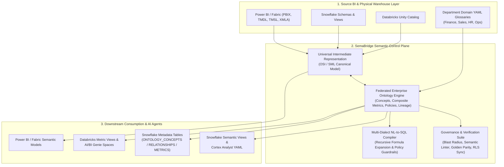
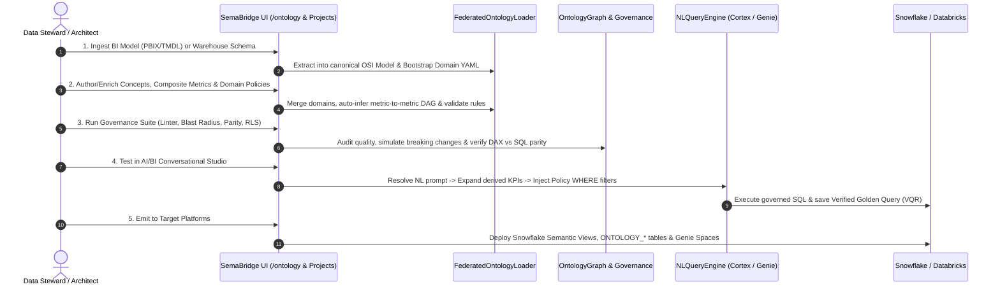

# SemaBridge: Enterprise Semantic Mesh, AI Context & Governance Architecture

> [!IMPORTANT]
> **Executive Summary:** SemaBridge is a vendor-neutral **Enterprise Semantic Control Plane** that bridges the gap between **Business Intelligence (Power BI / Fabric / Tableau)**, **Cloud Data Warehouses (Snowflake / Databricks)**, and **Enterprise AI Agents (Snowflake Cortex Analyst & Databricks AI/BI Genie)**. Beyond translating semantic models, SemaBridge governs cross-department business ontologies, enforces SQL-level domain policies, simulates downstream blast radius, and mathematically certifies numerical parity between BI and warehouse layers.

---

## 1. High-Level System Architecture

---

## 2. End-to-End Operational Flow

SemaBridge operates across a **5-stage lifecycle** that takes raw schemas or BI models and turns them into governed, AI-ready semantic assets:

---

## 3. Core Feature Pillars

### Pillar A: Universal Semantic Translation & Bidirectional Sync
* **Any-to-Any Model Compilation:** Converts between Power BI (`.pbix`, TMDL, TMSL), Snowflake (DDL, Semantic Views, Cortex YAML), and Databricks (Unity Catalog Metric Views) via the canonical Open Semantic Interchange (OSI) model.
* **DAX <-> SQL Transpiler:** Translates complex DAX measures (`CALCULATE`, `FILTER`, `SAMEPERIODLASTYEAR`, `DIVIDE`, time-intelligence) into optimized ANSI/Snowflake/Databricks SQL expressions.
* **Non-Destructive Round-Trip Sync:** Preserves human-authored business descriptions, synonyms, data stewards, and domain policies when re-syncing physical schema updates via `FederatedOntologyLoader.from_osi_model()`.

---

### Pillar B: Federated Enterprise Ontology & Semantic Mesh
Implemented in `src/semabridge/ontology/models.py`, `src/semabridge/ontology/federated_loader.py`, and `src/semabridge/ontology/graph.py`:

1. **Multi-Department Domain Federation:**
   * Each department (`Finance`, `Sales`, `Operations`) maintains its own YAML ontology file (`domains/*.yaml`).
   * SemaBridge merges domains into a unified `FederatedEnterpriseOntology` and automatically detects **Cross-Domain Metric Collisions** (e.g., if Finance and Sales define `revenue` with conflicting formulas).
2. **Typed Semantic Relationships (`RelationshipType`):**
   * Supports explicit semantic edge semantics beyond foreign-key joins:
     * `JOIN` — Physical table relationship (`MANY_TO_ONE`, `ONE_TO_MANY`, `ONE_TO_ONE`)
     * `DERIVES_FROM` — Metric-to-metric calculation lineage
     * `IS_A` — Taxonomic inheritance (`EnterpriseCustomer IS_A Customer`)
     * `APPLIES_TO` / `GOVERNED_BY` — Domain policy enforcement bindings
3. **Metric-to-Metric Lineage (`derives_from`) & DAG Validation:**
   * Composite metrics (e.g., `gross_margin = [revenue] - [cogs]`) explicitly or automatically declare upstream metric dependencies (`derives_from: [revenue, cogs]`).
   * `FederatedOntologyLoader._auto_infer_metric_dependencies()` parses bracketed `[metric]` and bare token references and validates the dependency graph against self-references and circular loops.
4. **Enforceable SQL Business Rules & Domain Policies (`DomainPolicy`):**
   * Concepts, metrics, and entire domains can carry executable SQL predicates (`filter_expression`, `DomainPolicy`)—such as `STATUS = 'ACTIVE' AND IS_DELETED = FALSE`—that are automatically enforced at query compilation time.
5. **Interactive 4-Column Lineage Graph:**
   * Visualized in `frontend/src/components/OntologyGraph.jsx` using ReactFlow + Dagre across 4 swimlanes:
     `Domain -> Business Concept -> Physical Table.Column -> Governed Metric` with interactive upstream/downstream highlighting and `DERIVES_FROM` metric dependency arcs.

---

### Pillar C: Multi-Target AI/BI Conversational Studio (Cortex & Genie)
Implemented in `src/semabridge/ai/nl_query_engine.py` and `src/semabridge/api/routers/ai_router.py`:

1. **Grounded Natural Language to SQL:**
   * Parses natural language prompts against governed concepts, synonyms, dimensions, and metrics—preventing LLM hallucinations.
2. **Recursive Composite Metric Expansion:**
   * `NLQueryEngine._expand_metric_expression()` recursively expands composite KPIs (`gross_margin` -> `(SUM(REVENUE)) - (SUM(COGS))`) before generating dialect-specific SQL for Snowflake, Databricks, or DuckDB.
3. **Automatic Policy Guardrail Injection:**
   * `NLQueryEngine._collect_policy_filters()` collects all applicable concept `filter_expression` rules, metric filters, `SQL:` business rules, and `DomainPolicy` predicates and injects them directly into the generated `WHERE` clause.
4. **Live Execution & Verified Golden Queries (VQR):**
   * Users can run generated SQL live against Snowflake, Databricks, or the local DuckDB sandbox and click **Verify & Save for AI** to persist the question-SQL pair into the **Verified Query Repository (VQR)** (`verified_queries` block in Cortex Analyst YAML & Genie instructions).

---

### Pillar D: Governance, Blast Radius, Data Reconciliation & Security Suite
Accessible in the UI under **`/ontology` -> Tab 4: `Governance, Blast Radius & Reconciliation`**:

| Capability | Backend Engine | API Endpoint | What It Solves |
| :--- | :--- | :--- | :--- |
| **1. Blast Radius Simulator** | `BlastRadiusAnalyzer` (`src/semabridge/governance/blast_radius.py`) | `POST /api/governance/blast-radius` | Simulates `DROP`, `RENAME`, or `MODIFY_EXPRESSION` on any column, table, or metric and reports impacted downstream metrics, Power BI reports, AI agents, severity (`BREAKING`/`DEGRADED`/`SAFE`), and remediation steps. |
| **2. Semantic Quality Linter** | `SemanticModelLinter` (`src/semabridge/governance/linter.py`) | `POST /api/governance/lint` | CI/CD gate that audits ontologies for missing descriptions, missing stewards, non-`snake_case` IDs, orphan concepts, and unresolved metric references. |
| **3. Golden Data Reconciliation** | `GoldenDatasetVerifier` (`src/semabridge/reconciliation/golden_verifier.py`) | `POST /api/reconciliation/generate-queries` `POST /api/reconciliation/verify` | Compiles paired Power BI DAX (`EVALUATE SUMMARIZECOLUMNS(...)`) and Warehouse SQL (`SELECT ... GROUP BY`) queries and performs cell-by-cell float tolerance comparison to issue a `CERTIFIED` or `FAILED` parity badge. |
| **4. Bidirectional RLS Compiler** | `RLSPolicySynchronizer` (`src/semabridge/security/rls_sync.py`) | `POST /api/security/rls/tmdl-to-snowflake` `POST /api/security/rls/snowflake-to-tmdl` | Translates Power BI TMDL security roles (`[Region] = "EMEA"`) into Snowflake `CREATE OR REPLACE ROW ACCESS POLICY` DDL and vice versa. |

---

### Pillar E: Snowflake Physical Ontology Metadata Emission
Implemented in `OntologyEmitter` (`src/semabridge/connectors/ontology_emitter.py`):

When deploying to Snowflake, SemaBridge materializes three physical relational tables alongside native `SEMANTIC VIEW` DDL so SQL analysts and Cortex agents can query ontology lineage directly:
1. **`ONTOLOGY_CONCEPTS`**: Stores both table-level `'ENTITY'` rows and column-level `'ATTRIBUTE'` rows with data types, roles (`DIMENSION`, `FACT`, `KEY`, `TIME`), synonyms, and stewards.
2. **`ONTOLOGY_RELATIONSHIPS`**: Stores physical `'JOIN'` relationships (`FROM_CONCEPT`, `TO_CONCEPT`, join keys, cardinality) and metric-to-metric `'DERIVES_FROM'` lineage edges.
3. **`ONTOLOGY_METRIC_BINDINGS`**: Stores governed metric definitions, `SQL_TEMPLATE`, `DAX_EXPRESSION`, `FILTER_EXPRESSION` guardrails, and `DERIVES_FROM` JSON arrays.

---

## 4. UI Navigation & Module Map

| UI Route / Screen | Component File | Key Capabilities |
| :--- | :--- | :--- |
| **`/ontology` — Tab 1: Domain Mesh & Business Glossary** | `frontend/src/components/OntologyDomainManager.jsx` | View federated domains, collision alerts, bootstrap domains from OSI models, upload YAML, and open the slide-over **Domain Glossary Inspector** to edit metrics, `derives_from`, `filter_expression`, concepts, and raw YAML. |
| **`/ontology` — Tab 2: Connection Map** | `frontend/src/components/OntologyGraph.jsx` | Interactive 4-column lineage DAG (`Domain -> Concept -> Table.Column -> Metric`), filterable by domain, search, and edge type (`links`, `maps_to`, `computes`, `derives`), with a detailed node inspector drawer. |
| **`/ontology` — Tab 3: AI/BI Conversational Studio** | `frontend/src/components/OntologyDomainManager.jsx` | Switch between **Snowflake Cortex**, **Databricks Genie**, and **Local DuckDB**. Ask natural language questions, inspect matched concepts, expanded `derives_from` metrics, injected `applied_policies`, execute SQL live, and save Verified Queries. |
| **`/ontology` — Tab 4: Governance, Blast Radius & Reconciliation** | `frontend/src/components/OntologyDomainManager.jsx` | Run the **Blast Radius Simulator**, **Semantic Quality Linter**, **Golden Data Reconciliation (DAX vs. SQL Parity)**, and **Bidirectional RLS Policy Compiler** in one unified dashboard. |
| **`/comparator` — Semantic Diff Viewer** | `frontend/src/pages/ComparatorPage.jsx` | Side-by-side structural comparison of two semantic models across tables, measures, relationships, and attributes. |
| **`/version-control` — Semantic Snapshots** | `frontend/src/pages/VersionControlPage.jsx` | Git-like version history, snapshot diffing, and one-click rollback for semantic models. |

---

## 5. Key Backend Codebase Reference

* **Ontology Core Models & Loader:**
  * `src/semabridge/ontology/models.py` — `DomainConcept`, `DomainMetric`, `DomainRelationship`, `DomainPolicy`, `RelationshipType`, `DomainOntology`, `FederatedEnterpriseOntology`
  * `src/semabridge/ontology/federated_loader.py` — YAML ingestion, metric DAG inference, cycle detection, collision reporting, OSI round-trip sync
  * `src/semabridge/ontology/graph.py` — 4-tier lineage graph builder (`Domain -> Concept -> Table.Column -> Metric` + `DERIVES_FROM` edges)
  * `src/semabridge/ontology/apply.py` — Ontology-to-OSI/SML enrichment
* **Snowflake & AI Emitters:**
  * `src/semabridge/connectors/ontology_emitter.py` — `ONTOLOGY_CONCEPTS`, `ONTOLOGY_RELATIONSHIPS`, `ONTOLOGY_METRIC_BINDINGS` DDL & DML emitter
  * `src/semabridge/ai/nl_query_engine.py` — Multi-dialect NL-to-SQL engine with composite metric expansion and policy injection
  * `src/semabridge/ai/cortex_generator.py` & `src/semabridge/ai/genie_generator.py` — Snowflake Cortex Analyst & Databricks Genie spec compilers
* **Governance, Reconciliation & Security:**
  * `src/semabridge/governance/blast_radius.py` — Downstream impact simulator
  * `src/semabridge/governance/linter.py` — Semantic model quality linter
  * `src/semabridge/reconciliation/golden_verifier.py` — DAX vs. SQL golden parity engine
  * `src/semabridge/security/rls_sync.py` — Bidirectional TMDL <-> Snowflake RLS compiler

