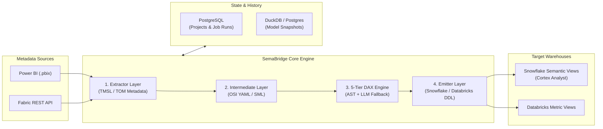

# 🌉 SemaBridge — Team Onboarding & Architecture Handbook

> **Target Audience:** Software Engineers, Data Engineers, and Technical Contributors joining SemaBridge.  
> **Goal:** Take any engineer from zero context to fully understanding the system, running it locally, making changes safely, and deploying code with automated quality gates.

---

## 📑 Table of Contents
1. [Executive Summary & High-Level Mission](#1-executive-summary--high-level-mission)
2. [End-to-End Architecture & Core Data Flow](#2-end-to-end-architecture--core-data-flow)
3. [Day 1 Setup: Getting Started Locally](#3-day-1-setup-getting-started-locally)
4. [Backend Deep-Dive (`src/semabridge/`)](#4-backend-deep-dive-srcsemabridge)
5. [Frontend Deep-Dive (`frontend/`)](#5-frontend-deep-dive-frontend)
6. [The 5-Tier DAX Translation Engine](#6-the-5-tier-dax-translation-engine)
7. [Database Schema, State & Version Control](#7-database-schema-state--version-control)
8. [Automated Quality Gates & Pre-Deploy CI/CD](#8-automated-quality-gates--pre-deploy-cicd)
9. [Developer How-To Guides (Extending SemaBridge)](#9-developer-how-to-guides-extending-semabridge)
10. [Troubleshooting, Gotchas & Best Practices](#10-troubleshooting-gotchas--best-practices)

---

## 1. Executive Summary & High-Level Mission

### The Problem
Enterprises invest years building rich semantic models in **Microsoft Power BI** (local `.pbix` files) and **Microsoft Fabric**, defining complex business metrics, DAX measures, hierarchies, and relationship graphs. 

However, modern cloud data platforms like **Snowflake** (via Cortex Analyst) and **Databricks** now offer native AI-powered semantic query engines. For these engines to answer natural language questions accurately, they require relational semantic views defined in SQL and YAML DDL.

Manually translating hundreds of Power BI tables, relationships, and nested DAX formulas into Snowflake SQL is slow, error-prone, and impossible to maintain as BI models evolve.

### The Solution: SemaBridge
**SemaBridge** is an enterprise data pipeline and semantic migration engine that bridges this divide:
- **Extracts** metadata directly from Power BI files (`.pbix` zip parsing) or live **Microsoft Fabric REST APIs**.
- **Normalizes** tables, columns, cardinalities, and measures into standard intermediate formats: **OSI (Open Semantic Intermediate)** YAML and **SML**.
- **Translates DAX formulas** into standard relational SQL expressions using a **5-Tier Translation Engine** (deterministic AST parser + relational pattern matching + LLM fallback).
- **Emits ready-to-run DDL** for Snowflake Semantic Views and Databricks Metric Views.
- **Orchestrates sync pipelines** with automated scheduling (cron/one-off), dry-run diff validation, DropLedger loss tracking, and version-controlled snapshots.

---

## 2. End-to-End Architecture & Core Data Flow



### The 10-Step Pipeline Execution Flow
Every synchronization run executes through a 10-step state machine:
1. **Config Ingestion:** Loads project configuration from `Config/projects/{project_id}.yaml` or PostgreSQL.
2. **Account Decryption:** Retrieves encrypted credentials for source (Fabric OAuth/Service Principal) and target (Snowflake Key-Pair/Password, Databricks Token).
3. **Source Extraction:** Parses `.pbix` data model zip entries or queries Fabric REST endpoints for workspaces/datasets.
4. **Intermediate Normalization:** Builds the uniform intermediate model (OSI YAML / SML).
5. **Relationship Graph Resolution:** Resolves table joins, primary/foreign keys, and cardinalities (`1:1`, `1:N`, `N:1`, `M:N`).
6. **DAX Formula Translation:** Translates DAX measures to relational SQL metric expressions via the 5-tier translator.
7. **DropLedger Auditing:** Any unsupported formula or incompatible column is recorded in the `DropLedger` to ensure zero-surprise data loss.
8. **Target DDL Generation:** Emits Snowflake SQL DDL (`CREATE OR REPLACE SECURE VIEW ...`) or Databricks view syntax.
9. **Target Deployment / Dry-Run Diff:** In Dry-Run mode, generates a visual side-by-side diff; in Live mode, executes DDL in the target warehouse.
10. **Version Snapshotting:** Commits a snapshot to the `model_versions` table for lineage and one-click rollback.

---

## 3. Day 1 Setup: Getting Started Locally

### Prerequisites
- **Python:** 3.10, 3.11, or 3.12 (Python 3.11 recommended)
- **Node.js:** v18+ or v20+ and `npm`
- **Database:** PostgreSQL (local or Docker container running on port 5432)
- **Git**

### Step-by-Step Installation

```bash
# 1. Clone the repository
git clone https://github.com/inarva-solutions-pvt-ltd/semabridge.git
cd semabridge

# 2. Set up Python virtual environment
python3.11 -m venv .venv
source .venv/bin/activate  # On Windows: .venv\Scripts\Activate.ps1

# 3. Install Python dependencies
pip install --upgrade pip
pip install -e .
pip install -r requirements.txt pytest-asyncio

# 4. Install Frontend dependencies
cd frontend
npm install
cd ..

# 5. Configure environment variables
cp .env.example .env
# Edit .env with your local PostgreSQL credentials (e.g. DATABASE_URL)

# 6. Run Database Migrations
make migrate
```

### Launching the Application
Open two terminal windows (or tabs):

```bash
# Terminal 1: Backend API (FastAPI + Uvicorn on http://127.0.0.1:8001)
make run

# Terminal 2: Frontend Dashboard (Vite on http://localhost:5180 or :5173)
make run-frontend
```

> [!TIP]
> **API Documentation:** Once the backend is running, open [http://127.0.0.1:8001/docs](http://127.0.0.1:8001/docs) in your browser to inspect interactive Swagger documentation for all REST API endpoints.

---

## 4. Backend Deep-Dive (`src/semabridge/`)

The backend is built with **FastAPI**, **SQLAlchemy ORM**, **APScheduler**, and **Pydantic**:

```
src/semabridge/
├── api/                        # FastAPI REST API Layer
│   ├── main.py                 # FastAPI application factory & lifespan
│   ├── routers/                # Endpoint routers (projects, jobs, connectors, repo, ai)
│   ├── services/               # Business logic services (run_service, sync_service)
│   ├── scheduler/              # APScheduler background runner for cron/one-off syncs
│   └── websocket_alerts.py     # Real-time WebSocket log streaming & telemetry
├── core/                       # Core Pipeline Engine
│   ├── engine/engine.py        # 10-step orchestrator
│   └── intermediate/           # OSI & SML semantic model schemas
├── connectors/                 # Inbound & Outbound Data Connectors
│   ├── local_pbix_connector.py # PBIX zip extractor & schema parser
│   ├── fabric_extractor.py     # Microsoft Fabric REST API client
│   ├── snowflake_emitter.py    # Snowflake Semantic View DDL compiler
│   └── databricks_publisher.py # Databricks Metric View compiler
├── dax_translation/            # 5-Tier DAX to SQL Translation Engine
│   ├── parser.py               # Lexer & Abstract Syntax Tree generator
│   ├── ast_visitor.py          # Relational SQL query tree compiler
│   ├── patterns.py             # Pattern matching for SUM, AVERAGE, DIVIDE, etc.
│   └── llm_fallback.py         # LLM prompt orchestration with local caching
├── repository/                 # Database Persistence & Models
│   ├── orm/                    # SQLAlchemy models (projects, runs, accounts, schedules)
│   └── session_factory.py      # Thread-safe database connection pool manager
└── migrations/                 # Alembic database migration revisions
```

---

## 5. Frontend Deep-Dive (`frontend/`)

The frontend is a single-page application built with **React 18**, **Vite**, **TailwindCSS**, and **Vanilla CSS custom properties**:

```
frontend/src/
├── components/
│   ├── CreateProjectWizard/    # 5-step interactive wizard (BasicInfo, Connectors, Sources, Mapping, Finish)
│   ├── RepositoryMap/          # ReactFlow ER Lineage canvas
│   │   ├── nodes/              # TableNode, ModelNode, MeasureNode
│   │   ├── DependencyGraph.jsx # Canvas controls, smoothstep edge routing, minimap
│   │   └── FileTreePanel.jsx   # Model & table hierarchy sidebar
│   ├── OntologyDomainManager.jsx # Domain taxonomy & business ontology mapping
│   ├── LeftNavigation.jsx      # Global navigation sidebar
│   └── Header.jsx              # Global header with theme toggle & command palette
├── pages/
│   ├── ProjectsPage.jsx        # Active projects grid & health summary
│   ├── ProjectDetailPage.jsx   # Project metrics, source tables, and execution triggers
│   ├── ProjectJobsPage.jsx     # Historical job runs, live logs & DropLedger audits
│   ├── ExplorePage.jsx         # Visual repository map & relationship graph
│   └── ComparatorPage.jsx      # Semantic model diff comparison
├── layouts/
│   └── DashboardLayout.jsx     # Master layout frame
└── index.css                   # Comprehensive Dual-Theme System (--bg-surface, --text-primary, --er-node-*)
```

### Theming Rules (Crucial for Developers)
SemaBridge supports seamless **Dark Mode** and **Light Mode**.
- **Rule 1:** Never hardcode dark colors (`#000`, `#0f172a`, `rgba(18, 20, 28, ...)`) or light colors (`#fff`, `#ffffff`) on components.
- **Rule 2:** Always use CSS variables:
  - Surface: `var(--bg-surface)`, `var(--bg-surface-raised)`, `var(--bg-surface-hover)`
  - Text: `var(--text-primary)`, `var(--text-secondary)`, `var(--text-tertiary)`
  - Borders: `var(--border-main)`, `var(--border-focus)`
  - Accents: `var(--accent-blue)`, `var(--color-success)`, `var(--accent-cyan)`

---

## 6. The 5-Tier DAX Translation Engine

DAX is a functional, context-sensitive calculation language with scalar, iterator, and table-filter functions. SemaBridge translates DAX to relational Snowflake SQL through five tiered layers:

```
[DAX Measure]
     │
     ▼
┌───────────────────────────────────────────────┐
│ Tier 1: Deterministic AST Syntax Trees        │ ──► Simple scalar functions (SUM, AVG, MIN, MAX)
└───────────────────────────────────────────────┘
     │ (if complex or unrecognized)
     ▼
┌───────────────────────────────────────────────┐
│ Tier 2: Relational Pattern Matching           │ ──► Safe division (DIVIDE), conditional IF/SWITCH
└───────────────────────────────────────────────┘
     │ (if nested filter context)
     ▼
┌───────────────────────────────────────────────┐
│ Tier 3: Cross-Table Filter Context Resolution │ ──► CALCULATE with FILTER, RELATED joins
└───────────────────────────────────────────────┘
     │ (if highly complex / windowing)
     ▼
┌───────────────────────────────────────────────┐
│ Tier 4: LLM-Assisted Translation              │ ──► Cortex / OpenAI fallback with local cache
└───────────────────────────────────────────────┘
     │ (if completely unsupported)
     ▼
┌───────────────────────────────────────────────┐
│ Tier 5: DropLedger & Graceful Degradation     │ ──► Logged with explanation; zero pipeline breakage
└───────────────────────────────────────────────┘
```

> [!NOTE]
> **Translation Caching:** Tier 4 translations are automatically cached in `.dax_translation_cache.jsonl`. Repeated runs never re-invoke the LLM for identical formulas, guaranteeing fast, deterministic deployments.

---

## 7. Database Schema, State & Version Control

SemaBridge maintains two distinct persistence concepts:

| Entity | Storage | Purpose | Lifecycle |
| :--- | :--- | :--- | :--- |
| **Active Projects** | PostgreSQL (`projects` table) + `Config/projects/*.yaml` | Defines active sync pipelines, credentials, source/target mappings, and cron schedules. | Created in Wizard; removed when user deletes a project. |
| **Job Runs** | PostgreSQL (`project_runs` table) | Execution history, duration, logs, status (`success`, `failed`, `dry_run`), and DropLedger reports. | Retained for auditability and compliance. |
| **Repository Snapshots** | PostgreSQL & DuckDB (`model_versions` table) | Version-controlled semantic model snapshots, relationship graphs, and metadata lineage. | Persisted independently of active projects to support rollback and historical exploration. |

---

## 8. Automated Quality Gates & Pre-Deploy CI/CD

To ensure code quality and prevent production regressions, SemaBridge implements a **Shift-Left Automated Quality Gate Pipeline**:

```
Developer Workstation                  Git Remote / PR
┌─────────────────────────────┐         ┌───────────────────────────────┐
│ make pre-deploy             │  ───►   │ GitHub Actions Workflow       │
│ (~8 seconds total)          │         │ (.github/workflows/pre_deploy)│
└─────────────────────────────┘         └───────────────────────────────┘
```

### The 5 Automated Quality Gates
1. **Gate 1: Secrets & Sensitive Files Scan:** Scans staged files for unencrypted `.env`, `.pem`, `.key`, or credentials.
2. **Gate 2: Python Bytecode & Syntax Validation:** Runs `compileall -q src/` to verify zero syntax errors or broken imports.
3. **Gate 3: Database & Migration Schema Check:** Validates SQLAlchemy ORM models and database connectivity.
4. **Gate 4: Backend Automated Regression Suite:** Executes `pytest` covering scheduler lifecycle, sync modes, delta upserts, and job run persistence.
5. **Gate 5: Frontend Production Bundle Build:** Runs `npm run build` inside `frontend/` to compile 3,000+ modules with zero errors.

### Developer Commands
```bash
# Run all quality gates locally
make pre-deploy

# Install automatic Git Pre-Push Hook (runs gates before any git push)
./scripts/setup_git_hooks.sh
```

---

## 9. Developer How-To Guides (Extending SemaBridge)

### How to Add a New DAX Function Translation
1. Open `src/semabridge/dax_translation/patterns.py`.
2. Add your function translation pattern or regex matching rule.
3. Add a unit test in `Tests/test_dax_translations.py`.
4. Run `pytest Tests/test_dax_translations.py -v`.

### How to Add a New Target Warehouse Connector
1. Create a new emitter file in `src/semabridge/connectors/` (e.g. `bigquery_emitter.py`).
2. Implement the standard interface:
   - `extract_schema()`
   - `compile_ddl(intermediate_model)`
   - `deploy_ddl(connection, ddl)`
3. Register the connector in `TARGET_CONNECTOR_TYPES` in `frontend/src/utils/constants.js`.

### How to Add a Database Migration
1. Modify or create models in `src/semabridge/repository/orm/`.
2. Generate an Alembic migration:
   ```bash
   alembic revision --autogenerate -m "describe change"
   ```
3. Apply migration:
   ```bash
   make migrate
   ```

---

## 10. Troubleshooting, Gotchas & Best Practices

| Issue / Gotcha | Cause | Solution |
| :--- | :--- | :--- |
| `ModuleNotFoundError: No module named 'semabridge'` | Python ran outside the virtual environment. | Always activate `.venv` or use `.venv/bin/python3`. |
| Port 8001 or 5180 already in use | Stale process from previous run. | Run `lsof -i :8001` (or `:5180`) and kill the process. |
| Inverted colors in Light Mode | Hardcoded hex or rgba background color. | Replace with CSS variable (`var(--bg-surface)`). |
| Explore page shows historical models after project deletion | Snapshots are stored in `model_versions` table. | This is intentional version control. Clear snapshots via Settings if a full reset is needed. |
| Database connection error | PostgreSQL service stopped or invalid password in `.env`. | Verify `.env` credentials and ensure PostgreSQL is running (`pg_isready`). |

---
*Document maintained by the SemaBridge Engineering Team.*
