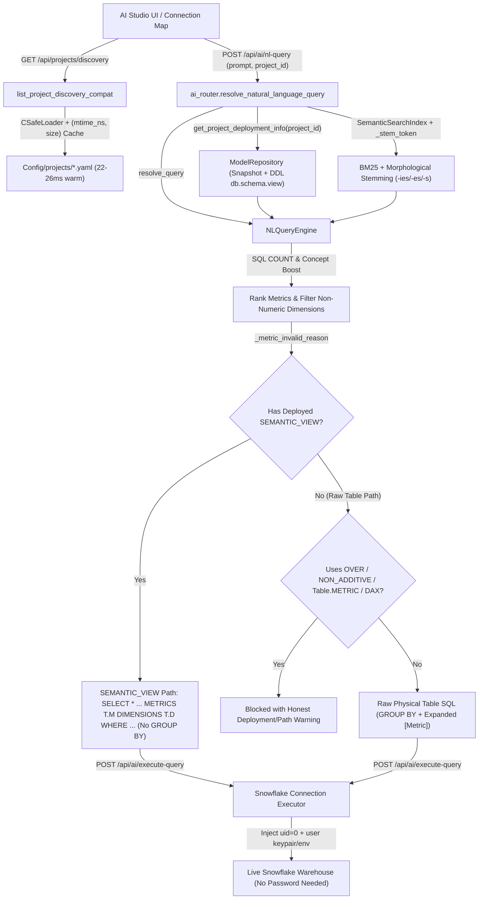
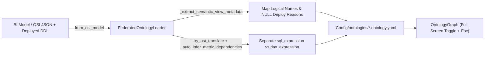

# SemaBridge Ontology, AI Query Engine & Validation Fixes (`ontology_validations`)

This directory implements SemaBridge's federated domain ontology models, OSI/DDL synchronization loader, persistence store, graph builder, and policy/lineage abstractions.  
Branch `ontology_validations` consolidates all Ontology, AI Studio NL-to-SQL, Snowflake `SEMANTIC_VIEW`, passwordless Snowflake execution, and UI performance/UX fixes verified across local enterprise models.

---

## Architecture & Query Flow Block Diagram



### OSI Sync & Governance Pipeline



---

## Summary of Fixes Included

### 1. Ontology Generation, Deployment Records & Logical Name Sync
- **`src/semabridge/api/routers/export_router.py` (`_load_osi_model`)**
  - Fixed broken imports (`ModelRepository`), snapshot lookup signature (`repo.get_head(project_id)` / `repo.get_snapshot(snapshot_id)`), and JSON/dict deserialization so `/from-osi` and Knowledge Graph previews succeed instead of raising hidden 404s.
- **`src/semabridge/repository/model_repository.py` (`get_project_deployment_info`)**
  - Resolves fully qualified `DATABASE.SCHEMA.VIEW_NAME`, active deployment errors (`deploy_error`), model name, and latest `semantic_view.sql` DDL directly from DB deployment records (`SnapshotRow`, `Project`, `run_model_results`) and reverse output artifacts.
- **`src/semabridge/ontology/models.py`, `federated_loader.py` & `api/routers/domain_ontology_router.py`**
  - Persists `logical_name`, `semantic_view_name`, `deploy_reason`, and domain `deployment_error` onto synced ontology items via `_extract_semantic_view_metadata` and deterministic `IdentifierSanitizer` aliases.
  - **SQL vs DAX separation:** Stores compiled SQL in `sql_expression` and BI formulas in `dax_expression` (with AST fallback translation), stopping raw DAX from leaking into generated SQL.
  - **Aggregation & relationship parity:** Preserves `NONE`/`CUSTOM` ratio aggregations (never coercing them to `SUM`), disambiguates role-playing relationships (`_rkey`), infers `derives_from` dependencies, enforces `DomainPolicy` / `filter_expression`, and updates domains in place by `source_project_id`.

### 2. AI Studio NL-to-SQL Routing, Generic Stemming & Safety Rules
- **`src/semabridge/api/routers/ai_router.py`**
  - Passes project deployment metadata (`semantic_view`, `deploy_error`, and `allowed_domains`) into `NLQueryEngine.resolve_query` so queries use the exact deployed `db.schema.view` and never bleed across domains.
  - Defaults `allow_simulated: bool = False` on `ExecuteQueryRequest` so unreachable warehouses report real errors instead of returning fabricated rows.
- **`src/semabridge/ai/semantic_search.py`**
  - **`_stem_token` morphological normalization:** Treats singular and plural forms uniformly across every token (`-ies` -> `-y`, `-ches/-shes/-xes/-zzes/-sses/-tuses/-nuses/-puses` -> strip `-es`, trailing `-s` -> singular) without any static word list (e.g., `actives` = `active`, `employees` = `employee`, `statuses` = `status`).
  - Indexes `metric.concept`, normalizes time-shift phrases before camelCase splitting (`year-to-date` -> `ytd`, `previous year` -> `py`, `same period last year` -> `sply`, `moving annual total` -> `mat`), adds bigram matching, and scopes fallback counts to `domain_filter`.
- **`src/semabridge/ai/nl_query_engine.py`**
  - **`SEMANTIC_VIEW` SQL correctness:** Generates `SELECT * FROM SEMANTIC_VIEW(db.schema.view METRICS TABLE.METRIC DIMENSIONS TABLE.DIM WHERE ...)` with no `GROUP BY`, `ORDER BY <first_metric> DESC`, and year/quarter filters placed inside `SEMANTIC_VIEW(... WHERE <date_dim>)` (never inventing `'date'`).
  - **No invented or numeric dimensions:** Unknown `'by X'` terms warn `"X not found"` with closest attribute suggestions instead of injecting `X.title()`; dimension selection is restricted to non-numeric domain attributes within `target_domain`.
  - **SQL `COUNT` detection (`_is_sql_count_metric`):** `"How many <X>"` detects metrics from their SQL `COUNT(...)` / `aggregation_type` / non-additive count definitions rather than `'count'` in the metric name (e.g., `SEPS` with `COUNT(CASE WHEN ...)` matches `"How many separations"`, while `SUM` metrics with `'count'` in their name are not misclassified).
  - **Concept alignment boost & subject gating:** Boosts metrics whose `concept` aligns with stemmed non-stopword tokens in the question (e.g., `"total open cases by agent"` picks `Case Count` over `Revenue Open`) and rejects modifier-only false positives (e.g., `"average salary"` does not match `Avg Age`).
  - **Raw-table execution guard (`_metric_invalid_reason`):** Rejects untranslated DAX and `NULL` placeholders everywhere, and rejects `OVER (...)` windows, `NON ADDITIVE` / `SNAPSHOT` definitions, and cross-metric column references (`"Table"."OTHER_METRIC"`, e.g. `"Employee"."ACTIVES_SPLY"`) whenever running outside a deployed `SEMANTIC_VIEW`.
  - **Safe composite expansion (`_expand_metric_expression`):** Expands only explicit `[Metric]` bracketed tokens (from both `derives_from` and inline `[...]` references), never bare words.

### 3. Passwordless Snowflake Auth & Semantic View Translation
- **`src/semabridge/api/routers/ai_router.py` (`execute_semantic_query`) & `connectors/snowflake_connection.py`**
  - Injects global (`owner_id=0`) Snowflake configuration first, followed by user-scoped DB credentials carrying auth secrets (`keypair`, `password`, `oauth`, `authenticator`) before reloading settings.
  - Supports passwordless env configuration via `SNOWFLAKE_AUTH_TYPE=keypair` (with `SNOWFLAKE_PRIVATE_KEY` or `SNOWFLAKE_PRIVATE_KEY_PATH`), `SNOWFLAKE_AUTH_TYPE=externalbrowser`, or `SNOWFLAKE_AUTH_TYPE=oauth`.
- **`src/semabridge/connectors/metrics_clause_builder.py` & `converter/dax_ast_parser.py`**
  - Strips `PARTITION BY EXCLUDING (...)` before physical schema checks and handles Leave-One-Out (`CALCULATE(..., ALL(FactTable))`) totals safely.

### 4. UI Latency Optimization & Connection Map Full-Screen Mode
- **`src/semabridge/api/services/project_projects_impl.py` & `frontend/src/components/OntologyDomainManager.jsx`**
  - Switched the **Generate Ontology from OSI Model** modal dropdown (`fetchProjects`) from `/api/projects?limit=50` to lightweight `GET /api/projects/discovery`.
  - Added `yaml.CSafeLoader` and an `(mtime_ns, size)` cache (`_DISCOVERY_FILE_CACHE`) in `list_project_discovery_compat` (cutting endpoint latency from `~5.8-26.5s` to `582.7 ms` cold / `22.7-25.6 ms` warm), and moved `_project_with_semantic_models` hydration after `[offset: offset + limit]` slicing in `list_projects_compat`.
  - Added `"Loading translated BI projects..."` status and duplicate-name disambiguation (`Name (project_id)`) in the OSI modal selector.
- **`frontend/src/components/OntologyGraph.jsx`**
  - Added a compact **Full screen** toggle (`Maximize2` / `Minimize2`) next to Reload plus `Escape` key exit handling, expanding Connection Map to `fixed inset-0 z-50` for wide graph inspection.

---

## Validation & Regression Checks

Run from `semabridge/`:

1. **Zero-hardcoding AST guard** (`0 hard-coded literal(s) in 7 file(s)` across 1,449 model identifiers + 22 business words):
   ```powershell
   .venv\Scripts\python.exe ontology_tests\t_no_hardcoding.py --changed
   ```
2. **Unit & ontology regression tests** (`27 passed`):
   ```powershell
   .venv\Scripts\pytest.exe Tests/test_ontology_emitter.py Tests/test_ontology_fixes.py Tests/test_ontology_graph.py Tests/test_window_exclusions_generic.py -v
   ```
3. **Frontend production bundle** (`vite build` exit code `0`):
   ```powershell
   cd frontend; npm run build
   ```
4. **Live Snowflake O09 end-to-end traces (`--execute`):**
   ```powershell
   .venv\Scripts\python.exe ontology_tests\o09_nl_query_trace.py --base http://127.0.0.1:8001 --q "Show case count by agent" --expect-metric "Case Count" --expect-dim Agent --project proj-ai --execute
   ```

See [ontology_tests/README.md](../../ontology_tests/README.md) for script-by-script details (`o01` through `o11` and `t_no_hardcoding.py`).
